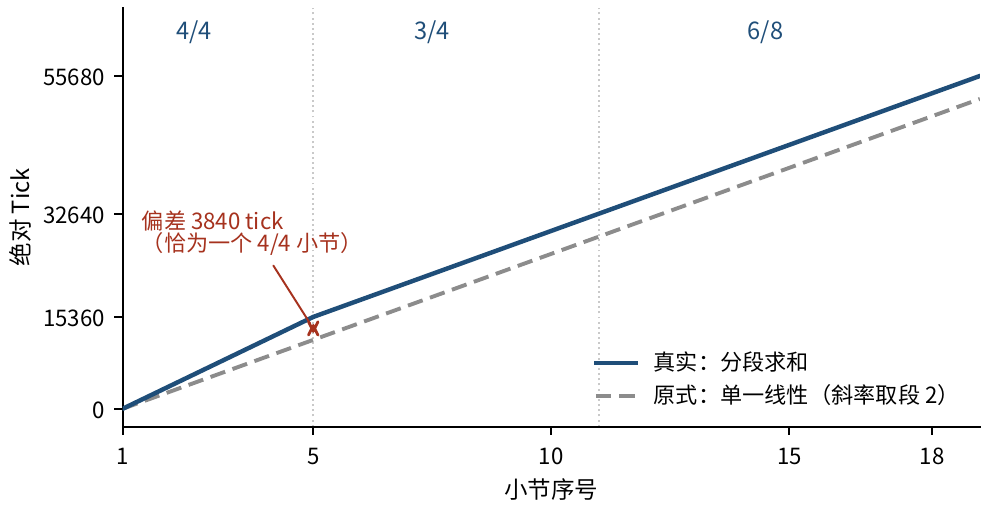
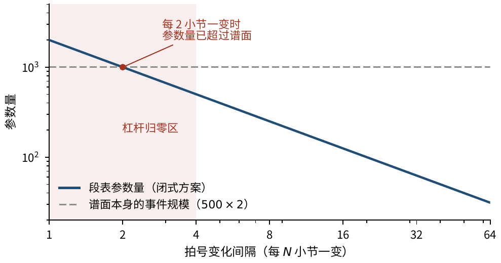
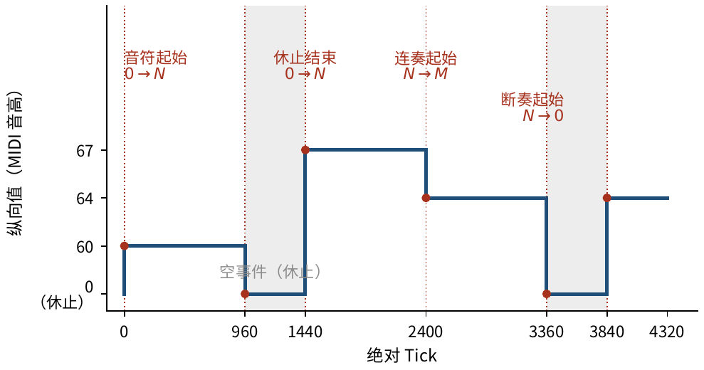
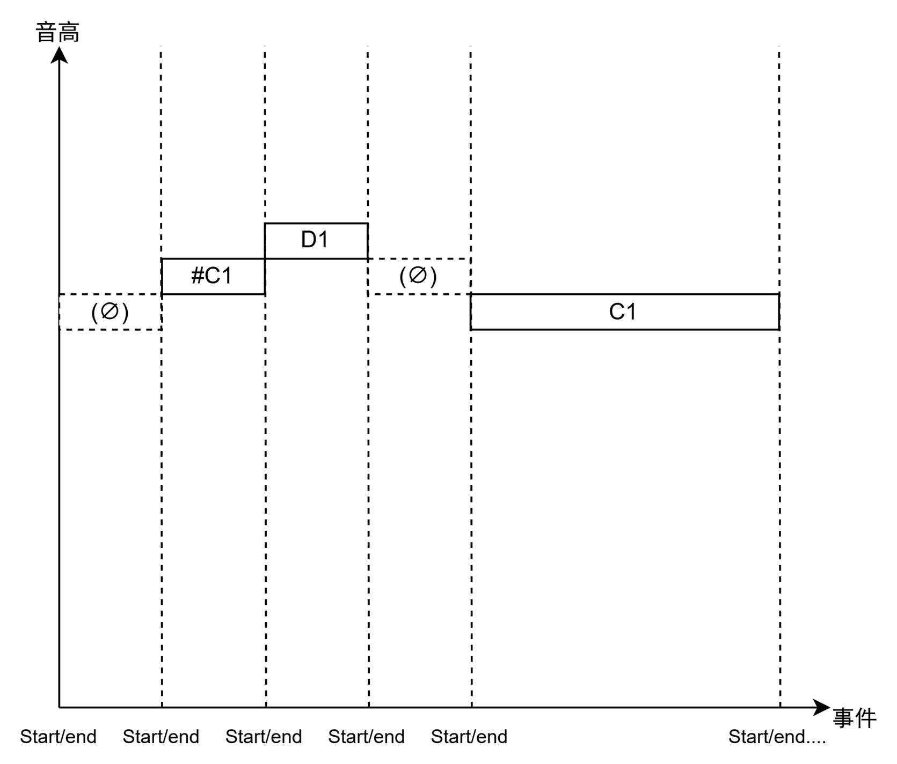
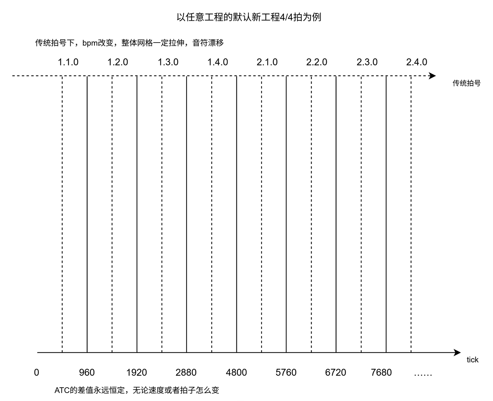
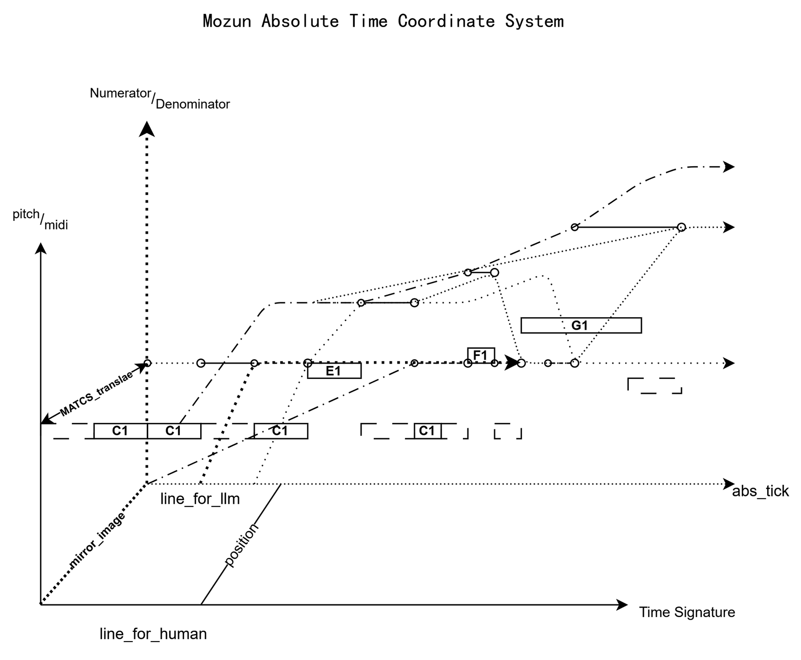
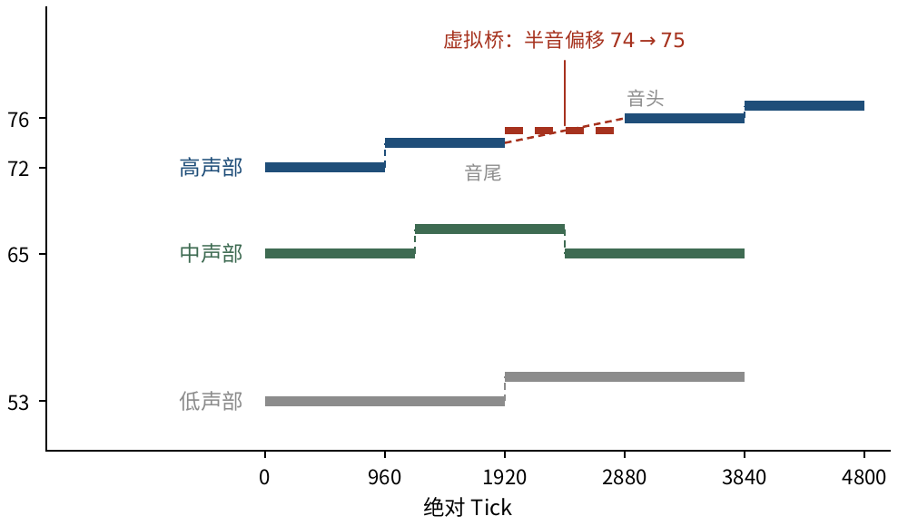
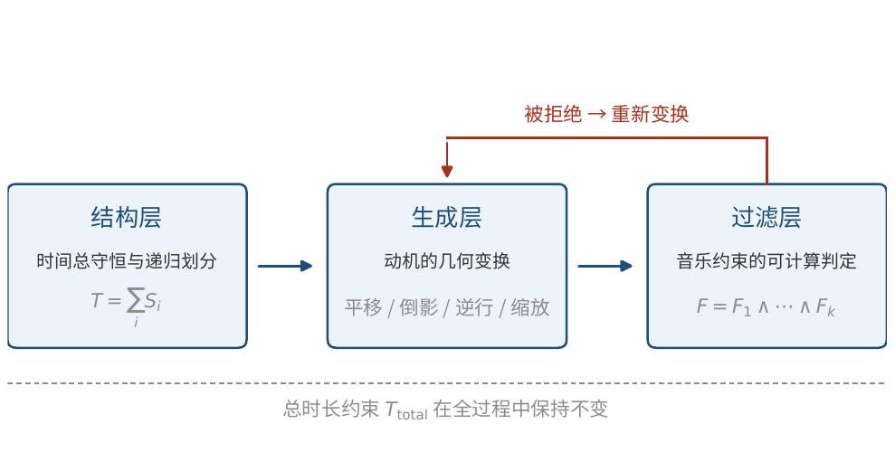
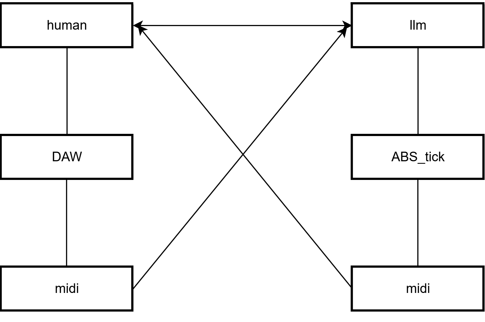

# MATCS: Absolute Spatiotemporal Coordinates of Musical Events

**MOZUN**　　Core Theory Project Group, Hefei 230000, Anhui, China

Correspondence: 368164331@qq.com

---

**Abstract.** Music has long been regarded as “the art of time” — transient, and hard
to measure exactly the way a painting can be. This paper argues that the
difficulty does not arise from the essence of music but from its metric:
the notational position expression “bar $m$, beat $t$” takes as its
unit of measurement one beat, which is itself parameterised by the time
signature, so that the same expression denotes different physical
durations under different signatures. **Change the time signature and
the scale changes with it.**

It is necessary first to clarify what this paper does **not** claim. The
conversion between bar–beat–tick and absolute tick
($\mathrm{AbsTick}=\bigl((M-1)\cdot\mathrm{BPI}+(T-1)\bigr)\cdot\mathrm{TPB}$,
where $\mathrm{TPB}=\mathrm{PPQ}\times4/\mathrm{Denom}$) is already
standard practice in digital audio workstations, symbolic music
libraries and game audio engines (for example the `FBarMap` interface of
the Unreal engine, and the time conversions of MusPy and mido), and this
paper **does not claim it as new**.

The contribution of this paper is built on that conversion and consists
of three items. First, **a unified symbolic-level event criterion**:
taking “event $=$ the instant at which the vertical value changes” as
the sole definition, so that the detection of note onsets, legato,
staccato and rests is reduced to one and the same condition; rests are
correspondingly redefined as **empty events** (events whose pitch
attribute is empty but whose onset and offset are explicit), so that no
undefined interval remains on the time axis. Second, **the closed form
under meter change and its degenerate property**: we give a
counterexample (the original formula errs by $3840$ ticks, exactly one
$4/4$ bar), generalise the original formula to a piecewise summation
form, and prove that the original formula is the degenerate special case
of that form when the number of time-signature segments is $n=1$.
Third, **a quantitative characterisation of the applicability domain**:
the parameter count of that form grows linearly with the density of
meter changes, and as that density approaches “one change per bar” the
parameter count approaches the score itself and the formula’s leverage
drops to zero, at which point the correct answer is not a better formula
but a paradigm shift (a time-signature event table $+$ binary search).

On this basis, this paper gives the voice-separation mechanisms derived
from these coordinates (coarse register partition, recursive
subdivision, the linking method with its “equidistance exclusion
method”, and a **virtual bridge** that bridges rest gaps), a
quantitative form for event relations (legato, staccato and large leaps
unified as local quantities that can be counted pair by pair), a
precision analysis, and a single observation from a human–AI
collaboration.

**Scope.** This paper does not infer meter from the audio waveform —
that assumption cannot be avoided; it does not give a strict upper bound
on the rounding error; it does not perform cross-implementation
validation; and it does not evaluate the musicality of the proposed
generation architecture.

**Keywords:** absolute tick; MATCS; spatiotemporal coordinate system; variable time
signature; event drawing; empty event; global localization

---

# Introduction

## Background and problem

The processing of symbolic music — editing, analysis, generation and
retrieval — all takes “the position of an event on the time axis” as its
common reference. In a digital audio workstation (DAW), however, that
reference is itself not stable: the position expression used by musical
notation, “bar $m$, beat $t$”, is a **relative** description whose
unit of measurement, one beat, is defined by the time signature. Once
the time signature changes, the physical duration denoted by the same
expression changes with it — **what changes is the ruler, not the thing
being measured**.

In engineering practice this property appears as three reproducible
classes of failure.

**(1) A time-signature switch causes positional drift.** The same
material edits normally under $4/4$, but after switching to $6/8$
its notes are systematically displaced and must be corrected by hand one
by one. The defect is ubiquitous in existing DAWs, yet the industry has
long accepted it as a “normal phenomenon”.

**(2) Moving material invalidates the coordinates.** After material is
moved between tracks, the relative relations among its internal notes
are unchanged, while its project-level absolute positions all become
invalid.

**(3) The landing point of generated output cannot be controlled.** When
a melody produced by a generative model is transferred into MIDI, its
landing points are always “close to but not equal to” the target beat
positions — by ear one can judge that the intention is bar $2$, beat
$3$, but that intention cannot be reproduced exactly.

The third phenomenon is often attributed to insufficient model
capability. That attribution does not hold: generative models perform
reliably on formal reasoning of the kind $1+1=2$, and their failure
here shows precisely that **the input representation itself lacks
computable precision**, not that their reasoning ability is
insufficient.

## Why this is a coordinate problem

Push the analogy towards physical measurement: “the $3$rd centimetre
of the $2$nd meter” is well defined — the ruler is fixed, and anyone
measuring at any time obtains the same result. Musical notation is not
like that: “bar $2$, beat $3$” denotes a different tick length under
$4/4$ and under $6/8$.

The substance of the problem is that the unit of measurement of that
expression is parameterised by the time signature. When the time
signature changes within a piece, the mapping “bar number $\to$ tick”
is no longer linear but **piecewise linear**. Existing implementations
treat the tick as a **counting tool** within one segment, whereas what
is needed here is a **coordinate system** that spans segments. The
difference between the two is exactly what this paper addresses.

**Observation.** What musical notation lacks is not precision but an absolute ruler that
is independent of every variable.

## Terminological clarification: irregular meter is not variable time signature
Before discussing this problem, a group of terms that have long been
conflated must be clarified. Existing accounts often call time
signatures such as $5/8$ and $7/8$ “mixed meter”, and conclude on
that basis that “complex time signatures are already covered”. That
classification is misleading in tick mathematics.

|  |  |  |  |
|:---|:---|:---|:---|
| Simple meter | $2/4$, $3/4$ | $2$, $3$ | No |
| Compound meter | $6/8$, $9/8$, $12/8$ | $6$, $9$, $12$ | No (each “beat” is a dotted note) |
| Irregular meter | $5/8$, $7/8$ | $5$, $7$ | **No** (unequal division within the bar) |
| **Variable time signature** | the signature changes mid-piece | **piecewise values** | **Yes** |

The point is this: for the first three classes in Table
[1](#tab:meter){reference-type="ref" reference="tab:meter"} the BPI is a
**constant** throughout the whole piece, and however irregular its value
may be (whether $7/8 = 2+2+3$ or $5/8 = 3+2$), the bar length
$\mathrm{barLen}=\mathrm{BPI}\times\mathrm{TPB}$ never changes, so the
coordinate mapping is still linear. What is called “irregular meter”
refers to an unequal grouping **inside** the bar; the time signature
itself does not change, and the tick mathematics is entirely unaffected
by the internal grouping.

**Observation.** What genuinely requires segmentation is **variable time signature**,
that is, the signature being changed mid-piece. And that is precisely
the class that existing validation never covered — the original formula
passes on $4/4$, $6/8$ and $7/4$ and fails only under a changing
signature (see section [3.7](#sec:counter){reference-type="ref"
reference="sec:counter"}).

## The contributions of this paper and what it does not claim

It must first be made clear what this paper **does not claim**. The
linear conversion between bar–beat–tick and absolute tick is already
standard practice in digital audio workstations, symbolic music
libraries and game audio engines: the Unreal engine encapsulates it in
the `MusicTimestampBarBeatTickToTick` interface of its `FBarMap` class,
libraries such as MusPy and mido provide equivalent time conversions,
and the commit records of some open-source DAWs even contain entries
that specifically fix an “off-by-one” problem in that conversion. **This
paper therefore does not claim the conversion as a new mathematical
result**; writing it as a closed form merely provides an explicit base
for the arguments that follow.

On that base, this paper makes three contributions.

**(1) A unified symbolic-level event criterion (section
[4](#sec:event){reference-type="ref" reference="sec:event"}).** Taking
“event $=$ the instant at which the vertical value changes” as the
sole definition reduces the detection of the four kinds of boundary —
note onset, legato, staccato and rest — to one and the same condition;
rests are correspondingly redefined as “empty events”, and no undefined
interval remains on the time axis. The benefit of this item is testable
— four conditions that used to be handled separately are replaced by a
single criterion.

**(2) The closed form under a changing time signature and its degenerate
property (section [3](#sec:coord){reference-type="ref"
reference="sec:coord"}).** We give a counterexample (the original
formula errs by $3840$ ticks, exactly one $4/4$ bar), generalise the
single linear formula to a piecewise summation form, and prove that the
original formula is the degenerate special case of that form when the
number of time-signature segments is $n=1$. The practical significance
of the degenerate property is that replacing the implementation changes
no behavior of a single-signature project, so it can be deployed safely.

**(3) A quantitative characterisation of the applicability domain
(section [3](#sec:coord){reference-type="ref" reference="sec:coord"}).**
The parameter count of that form grows linearly with the density of
time-signature changes; as the density approaches “one change per bar”
the parameter count approaches the score itself, and the formula’s
leverage relative to directly listing the data drops to zero. **Pointing
out when a method should be abandoned is as important as giving the
method itself.**

On top of this, the paper gives several mechanisms derived from those
coordinates — voice separation (section
[5.2](#sec:voice){reference-type="ref" reference="sec:voice"}), the
quantification of event relations (section
[5.1](#sec:relation){reference-type="ref" reference="sec:relation"}) and
precision analysis (section [3.8](#sec:precision){reference-type="ref"
reference="sec:precision"}). They are **all derived quantities of the
coordinate system rather than methods in their own right**; this point
is stated again at the beginning of each relevant chapter.

## What this paper does not cover

To avoid misunderstanding, the following are outside the scope of this
paper.

1.  **It does not infer the beat or the time signature from the audio
    waveform.** That is a probabilistic estimation problem in Music
    Information Retrieval; this paper assumes that the segment table is
    supplied externally, and proposition
    [$$
prop:notick
$$](#prop:notick){reference-type="ref"
    reference="prop:notick"} shows that this assumption cannot be
    avoided.

2.  **It does not claim that musical aesthetics can be replaced by
    numbers.** This paper deals only with position and length, not with
    “whether it sounds good”.

3.  **It does not give a strict upper bound on the rounding error under
    a changing time signature**; only experimental observation is
    offered (see section [3.9.4](#sec:limit){reference-type="ref"
    reference="sec:limit"}).

4.  **It does not provide cross-implementation validation.** The
    experiments were carried out on a single DAW only.

5.  **It does not validate the musicality of the proposed generation
    architecture.** The two worked examples in section
    [6](#sec:gen){reference-type="ref" reference="sec:gen"} verify the
    consistency of conservation and transformation, not the quality of
    the resulting piece.

## Organisation of the paper

Section [2](#sec:related){reference-type="ref" reference="sec:related"}
reviews related work and locates the difference between this paper and
existing work; section [3](#sec:coord){reference-type="ref"
reference="sec:coord"} establishes the core coordinate system; sections
[4](#sec:event){reference-type="ref"
reference="sec:event"}–[7](#sec:semantic){reference-type="ref"
reference="sec:semantic"} give corollaries at four levels; section
[8](#sec:collab){reference-type="ref" reference="sec:collab"} discusses
the application of these corollaries in human–AI collaboration; section
[9](#sec:exp){reference-type="ref" reference="sec:exp"} reports the
implementation and the experiments; section
[10](#sec:disc){reference-type="ref" reference="sec:disc"} discusses
limitations and boundaries.

# Related work
## Symbolic music representation

There are two main lines of machine representation for symbolic music.
The first is MIDI and its standard file format [^1], which records
performance information as a stream of event messages and whose time
base is the product of “pulses per quarter note” (PPQ) and tempo, which
does not correspond directly to the bar–beat structure of notation. The
second is notation description languages such as MusicXML [^2] and
Humdrum [^3], which faithfully describe the visual and structural
information of a score, but precisely for that reason their position
expressions always remain tied to a time-signature context.

**Remark.** Each of the two representations has its strengths, but neither provides
an absolute position quantity that is independent of the time signature.
What this paper deals with is neither a performance message sequence nor
a score document structure, but the **mapping layer** between the two.

## Computational models of beat, time signature and time

The automatic inference of time signatures and beats is a classic
problem in Music Information Retrieval (MIR), covering subtasks such as
beat tracking, downbeat detection and meter detection, and the relevant
methods are mostly based on statistical estimation [^4]. Such work
differs from the present problem in one fundamental respect: MIR asks
“what might the time signature be”, which is a **statistical inference**
problem; this paper asks “given the time signature, how is a position
mapped exactly to a coordinate”, which is a **deterministic
computation** problem.

This yields a conclusion worth pointing out separately:

**Proposition.** <span id="prop:notick" data-label="prop:notick"></span> In raw MIDI or
audio data, the time-signature map cannot be recovered uniquely from a
tick sequence.

**Proof.** *Proof.* The same tick data (for example $0,480,960,\dots,3360$) is
interpreted as $1$ bar under $4/4$, as $2$ bars under $2/4$, and
as yet other structures under $3/4$ and $6/8$. Multiple solutions
exist, hence there is no unique solution, and the inverse problem is
ill-posed. ◻

Automatic inference of the time signature can therefore give only a
statistical estimate and no exact solution, which shows from the other
side that the segment table must be **externally supplied prior
metadata** and cannot be recovered from the coordinates (see section
[3.9](#sec:domain){reference-type="ref" reference="sec:domain"} for
details).

## Computational musicology toolchains

The field of computational musicology has developed mature toolchains
[^5]; the formal description of tonal structure is represented by
generative grammar theory [^6]; and the mechanisms of temporal
expectation for musical events have likewise been studied systematically
in psychology [^7]. Most of this work discusses musical structure within
an established metrical context, whereas this paper treats the metrical
context itself as the variable to be dissolved.

## Absolute read-outs in DAW software

Modern DAWs generally provide an absolute read-out of the form
“bar.beat.tick” (for example REAPER’s Big Clock window [^8]). That
read-out is stable and unique within a project and does not drift with
tempo or with other time-signature segments; but when the time signature
is changed mid-project, if event coordinates are generated by a single
linear formula such as equation
[$$
eq:abs
$$](#eq:abs){reference-type="eqref" reference="eq:abs"}, a
systematic offset appears. The internal implementation of DAW software
uses a time-signature event table plus interval lookup, and does not
expose a closed-form expression for the case of a changing time
signature [^9]. One part of this paper’s work is to supply that closed
form, and at the same time to delimit its applicability boundary.

## Comparison with the standard MIDI tick

The absolute time unit defined in this paper is not the same concept as
the tick of the MIDI standard; the differences between the two are given
in Table [2](#tab:vsmidi){reference-type="ref" reference="tab:vsmidi"}.

**Table 1**　The properties of four classes of time signature in tick mathematics

|  |  |  |
|:---|:---|:---|
| Relation to tempo | Coupled (a change in BPM directly affects the physical duration) | Decoupled (only the logical density changes) |
| Relation to the time signature | Implicitly dependent; must be inferred together with tempo and time signature | Explicitly decoupled; computed directly through TPB adaptation |
| Cross-segment consistency | Inconsistent; segments with different PPQ are not interchangeable | Consistent; forms a unified coordinate system within one project |
| Mathematical mapping | No direct mapping from “bar.beat” is given | Gives a “minus-one shift $+$ time-signature adaptation” mapping |
| Systematic architecture | None | Covers single-point localization, global recursion and structural verification |

Comparison of the standard MIDI tick with the absolute time unit of this
## Limitations of DAW software itself

Worth pointing out separately: the developers of DAW software are
clearly aware of the tick inconsistency problem. In documenting its
absolute tick input facility, REAPER’s official documentation notes that
because the software allows MIDI segments with different PPQ to coexist,
**a tick in one segment may not be equivalent to a tick in another**
[^10].

This remark delimits exactly the boundary of existing implementations:
what they provide is a counting tool **within a segment**, not a
coordinate system **unified across segments**. It is the latter that
this paper supplies.

## Division of labour with Music Information Retrieval

Beat tracking and onset detection in Music Information Retrieval take
the audio waveform as their object and output probability estimates;
this paper takes a symbolic event representation (such as MIDI) as its
object and outputs deterministic coordinates. The two do not compete:
the former answers “what might the time signature be”, the latter
answers “given the time signature, how is a position mapped exactly”. By
proposition 1, the former cannot in principle give an exact solution,
which shows from the other side that the segment table must be supplied
externally.

## Existing bar–beat–tick conversions

This section sets out in one place the part that this paper **does not
claim**, so that readers do not misjudge the scope of its contribution.
The linear conversion from notational position to absolute tick is
already a mature practice in several engineering fields; Table
[3](#tab:priorart){reference-type="ref" reference="tab:priorart"} lists
some of the implementations for which public documentation exists.

**Table 2**　paper

|  |  |  |
|:---|:---|:---|
| Unreal Engine | the `FBarMap` class | Provides the `MusicTimestampBarBeatTickToTick` interface: bars and beats are both counted from 1 and ticks from 0, returning a 0-based absolute tick from the start of the piece; the documentation states this convention explicitly |
| MusPy | symbolic music library | implements the same mapping through a conversion between `resolution` (that is, PPQ) and metrical time |
| mido | MIDI library | `midifiles/units.py` provides conversion utilities between ticks and time units |
| madmom | MIR library | its MIDI IO contains an equivalent conversion between ticks and beat positions |
| the tempo map of an open-source DAW | source commit | commits exist that specifically fix the “off-by-one” problem between bar offset and beat arithmetic |

Existing bar–beat–tick conversion implementations (not claimed as new by
Two points are visible from Table
[3](#tab:priorart){reference-type="ref" reference="tab:priorart"}.
First, the **content** of that conversion is public prior art. Second,
even the convention “bars and beats counted from 1, ticks counted from
0” is not this paper’s invention — Unreal’s interface documentation
states it explicitly. This paper therefore claims neither the
mathematical content of the conversion nor its counting convention.

What must be distinguished is an **implementation** from a **closed
form**. Most of the implementations above work by means of a **time
signature map plus interval lookup** (Unreal’s documentation states that
it is based on a time signature map), and do not expose a closed-form
expression for the case of a changing time signature. The work of this
paper here is **making explicit** rather than discovery; its value lies
not in the formula itself but in the criterion, the degenerate property
and the applicability boundary derived from it (section
[3](#sec:coord){reference-type="ref" reference="sec:coord"}).

## How this paper differs from existing work

In summary, this paper does not claim that the quantifiability of music
is a new problem; it claims three things. First, the unit “one beat”
must be relativised under a changing time signature, and that
relativisation has not been written out explicitly in existing accounts.
Second, the piecewise summation form that follows from it has a definite
degenerate property and can serve as a consistent extension of the
original formula. Third, the effective range of that form is constrained
by the density of time-signature changes, beyond which a paradigm shift
is required. Section [3.9](#sec:domain){reference-type="ref"
reference="sec:domain"} gives a quantitative characterisation of that
boundary.

# The absolute spatiotemporal coordinate system: a position representation independent of the time signature
This section is the technical foundation of the whole paper. Every
conclusion in the sections that follow can be derived directly from the
three definitions given here (the TPB conversion base, the absolute
tick, and the bidirectional mapping), without introducing any new
independent assumption. This section therefore also carries the
responsibility of delimiting boundaries: wherever this coordinate system
does not hold, the corollaries built on it fail with it, so the
applicability domain and the failure mechanism are discussed here as
well.

It is worth restating the conclusion of section
[2](#sec:related){reference-type="ref" reference="sec:related"}: the
conversion in this section is **not a new mathematical result** (see
Table [3](#tab:priorart){reference-type="ref"
reference="tab:priorart"}). The substantive work of this section is
twofold — generalising that conversion to a piecewise summation form
under a changing time signature and proving that the original formula is
its degenerate special case, and giving the quantitative boundary of its
applicability domain. Readers interested only in the contributions may
go straight to sections [3.7](#sec:counter){reference-type="ref"
reference="sec:counter"} and [3.9](#sec:domain){reference-type="ref"
reference="sec:domain"}.

## Observation: the stability of the scale

In DAW software, a read-out of the form “bar.beat.tick” remains stable
when the time signature, the tempo or the position of the material
changes. Table [4](#tab:clock){reference-type="ref"
reference="tab:clock"} gives the carry rules under three time
signatures.

**Table 3**　this paper)

|  |  |  |
|:---|:---|:---|
| $4/4$ | 1.1.00 $\to$ 1.2.00 $\to$ 1.3.00 $\to$ 1.4.00 $\to$ 2.1.00 | every four beats carry one bar |
| $6/8$ | 1.1.00 $\to$ 1.2.00 $\to \cdots \to$ 1.6.00 $\to$ 2.1.00 | every six beats carry one bar |
| $3/4$ | 1.1.00 $\to$ 1.2.00 $\to$ 1.3.00 $\to$ 2.1.00 | every three beats carry one bar |

This rule is isomorphic to a positional numeral system: the bar is the
high-order digit, the beat the low-order digit, and the numerator of the
time signature determines the carry radix. This observation suggests
that the position expression can be formalised as a purely counting
mapping.

## The conversion base: from PPQ to TPB

**Definition.** Let $\mathrm{PPQ}$ be the system’s preset time resolution (pulses per
quarter note) and $\mathrm{Denom}$ the denominator of the current time
signature; then the number of numerical coordinate units per beat is
defined as
$$
\mathrm{TPB} = \frac{\mathrm{PPQ}\times 4}{\mathrm{Denom}} .
$$

Equation [$$
eq:tpb
$$](#eq:tpb){reference-type="eqref"
reference="eq:tpb"} is the **unit calibration** of every coordinate
conversion in this paper: it translates the musicological unit “one
beat” into a number of machine-comparable numerical units. Table
[5](#tab:tpb){reference-type="ref" reference="tab:tpb"} gives the common
values ($\mathrm{PPQ}=960$).

**Table 4**　Counting carry rules under different time signatures

|         |     |     |     |      |
|:--------|:---:|:---:|:---:|:----:|
| $4/4$ |  4  |  4  | 960 | 3840 |
| $3/4$ |  4  |  3  | 960 | 2880 |
| $6/8$ |  8  |  6  | 480 | 2880 |

**Remark.** $\mathrm{TPB}$ corresponds one-to-one with the time signature:
different signatures correspond to different values, and the same
signature corresponds to the same value in any project. It must be
stressed that this correspondence presupposes **adopting the DAW’s
convention for “one beat”** — under $6/8$ the DAW defines one beat as
an eighth note ($\mathrm{TPB}=480$), whereas in music theory $6/8$
is usually read as two dotted quarter notes. Adopt a different
convention for the beat unit and the read-out changes with it (see
precondition C in section [3.9](#sec:domain){reference-type="ref"
reference="sec:domain"}).

## The definition of the absolute tick

**Definition.** <span id="def:defn" data-label="def:defn"></span> Let the start of the
project be $1.1.00$, let $M$ denote the bar number, $T$ the beat
number and $\mathrm{BPI}$ the number of beats per bar; then the
absolute tick of the position $(M,T)$ is defined as
$$
\mathrm{AbsTick}(M,T) = \bigl((M-1)\cdot \mathrm{BPI} + (T-1)\bigr)\times \mathrm{TPB}.
$$

The reasoning behind equation
[$$
eq:abs
$$](#eq:abs){reference-type="eqref" reference="eq:abs"} is:
$(M-1)\cdot\mathrm{BPI}$ is the total number of beats before the
current bar, $(T-1)$ is the number of beats already elapsed within the
current bar, and multiplying by $\mathrm{TPB}$ converts the result
into a number of absolute ticks.

The two $-\,1$ terms in definition
[$$
def:defn
$$](#def:defn){reference-type="ref" reference="def:defn"} are
not a mathematical convention but the alignment of the counting origins:
a notational position is counted from $1$, while the tick count starts
from $0$. Omitting that alignment introduces a systematic bias of “one
bar plus one beat”, as Table [6](#tab:minusone){reference-type="ref"
reference="tab:minusone"} shows.

**Table 5**　Values of TPB ($\mathrm{PPQ}=960$)

|  |  |  |  |
|:---|:--:|:--:|:--:|
| `1.1.00` | $(1\times 4+1)\times 960=4800$ | $((1-1)\times 4+(1-1))\times 960=0$ |  |
| `2.1.00` | $(2\times 4+1)\times 960=8640$ | $((2-1)\times 4+(1-1))\times 960=3840$ |  |
| `1.3.00` | $(1\times 4+3)\times 960=6720$ | $((1-1)\times 4+(3-1))\times 960=1920$ |  |

The effect of aligning the counting origins ($4/4$,
**Remark.** The $-\,1$ in equation [$$
eq:abs
$$](#eq:abs){reference-type="eqref"
reference="eq:abs"} is a **translation rule** rather than a mathematical
rule: it maps a human coordinate counted from $1$ onto a machine
coordinate counted from $0$. Remove that shift and every position
moves by “one bar plus one beat” as a whole.

## Event coordinatization

Taking the absolute tick as the horizontal axis of a Cartesian
coordinate system and the event pitch $P$ as the vertical axis gives
the two-dimensional event coordinate:
$$
\mathrm{Event} = (\mathrm{AbsTick},\; P).
$$

Every event therefore has a unique start and end absolute coordinate
$(\mathrm{Start}_{\mathrm{absTick}},\;\mathrm{End}_{\mathrm{absTick}},\;P)$,
whose localization does not depend on the time-signature context.
Equation [$$
eq:event
$$](#eq:event){reference-type="eqref"
reference="eq:event"} provides a unified mathematical framework for
voice separation, melody tracking and harmonic analysis.

## Bidirectional mapping

The inverse mapping can be derived from equation
[$$
eq:abs
$$](#eq:abs){reference-type="eqref" reference="eq:abs"}.
Writing $\mathrm{TotalBeats}=\mathrm{AbsTick}/\mathrm{TPB}$, we have
$$
\mathrm{TotalBeats} &= \mathrm{AbsTick} / \mathrm{TPB}, \\
  M &= \bigl\lfloor \mathrm{TotalBeats} / \mathrm{BPI} \bigr\rfloor + 1, \\
  T &= \bigl(\mathrm{TotalBeats} \bmod \mathrm{BPI}\bigr) + 1 .
$$

Equation [$$
eq:abs
$$](#eq:abs){reference-type="eqref"
reference="eq:abs"} together with equations
[$$
eq:tb
$$](#eq:tb){reference-type="eqref"
reference="eq:tb"}–[$$
eq:invT
$$](#eq:invT){reference-type="eqref"
reference="eq:invT"} forms a complete inference loop, ensuring that the
localization process is unambiguous and traceable.

## Verification

Under $6/8$ ($\mathrm{BPI}=6$, $\mathrm{Denom}=8$,
$\mathrm{PPQ}=960$, hence $\mathrm{TPB}=480$) take `4.1.00` for the
forward computation:
$$
\bigl((4-1)\times 6+(1-1)\bigr)\times 480 = 18\times 480 = 8640 .
$$
Substituting back into equations
[$$
eq:invM
$$](#eq:invM){reference-type="eqref"
reference="eq:invM"}–[$$
eq:invT
$$](#eq:invT){reference-type="eqref"
reference="eq:invT"} gives a total of $8640/480=18$ beats,
$M=\lfloor 18/6\rfloor+1=4$ and $T=(18 \bmod 6)+1=1$, that is
`4.1.00`, which agrees with the input. Table
[7](#tab:verify){reference-type="ref" reference="tab:verify"} summarises
the verification data.

**Table 6**　$\mathrm{BPI}=4$, $\mathrm{TPB}=960$)

|         |          |     |     |       |          |     |
|:--------|:---------|:---:|:---:|:-----:|:--------:|:---:|
| $4/4$ | `2.3.00` |  2  |  3  | 5760  | `2.3.00` |     |
| $6/8$ | `4.1.00` |  4  |  1  | 8640  | `4.1.00` |     |
| $6/8$ | `5.3.00` |  5  |  3  | 12480 | `5.3.00` |     |

## A changing time signature: counterexample and generalisation
### The implicit assumption of the original formula

Consider the $(M-1)\cdot\mathrm{BPI}$ term in equation
[$$
eq:abs
$$](#eq:abs){reference-type="eqref" reference="eq:abs"}: it
uses the **current $\mathrm{BPI}$ to multiply the total number of
bars**. This step assumes that all bars in the project have exactly the
same length.

As long as that assumption holds, equation
[$$
eq:abs
$$](#eq:abs){reference-type="eqref" reference="eq:abs"} is
**exact** (not an approximation), and the verifications above on
$4/4$, $6/8$ and $7/4$ are all valid. But as soon as the time
signature changes mid-project, the assumption is broken.

### Counterexample



**Figure 1**　The deviation between the single linear formula and piecewise summation under a changing time signature. The dashed line is the original formula (multiplying by the BPI of segment 2), the solid line is the true piecewise accumulation; the two separate from bar $5$ onwards, and the deviation is constantly $3840$ ticks, exactly one $4/4$ bar.

Consider a project with three time-signature segments, with the
parameters given in Table [8](#tab:segdata){reference-type="ref"
reference="tab:segdata"}.

**Table 7**　Bidirectional verification ($4/4$ and $6/8$)

|           |               |         |     |                      |     |
|:----------|:--------------|:-------:|:---:|:--------------------:|:---:|
| Segment 1 | $1$–$4$   | $4/4$ | 960 | $4\times 960=3840$ |     |
| Segment 2 | $5$–$10$  | $3/4$ | 960 | $3\times 960=2880$ |     |
| Segment 3 | $11$–$18$ | $6/8$ | 480 | $6\times 480=2880$ |     |

We want the absolute tick of bar $5$, beat $1$ (`5.1.00`).
Substituting into equation [$$
eq:abs
$$](#eq:abs){reference-type="eqref"
reference="eq:abs"} and using the $\mathrm{BPI}=3$ of segment 2:
$$
\bigl((5-1)\times 3 + (1-1)\bigr)\times 960 = 4\times 3\times 960 = 11520 \quad(\text{wrong}).
$$
Whereas by piecewise accumulation, the first $4$ bars are $4/4$ and
should give
$$
4\times 4\times 960 = 15360 \quad(\text{right}).
$$

**Observation.** The error is $15360-11520 = 3840$ ticks, **exactly one $4/4$ bar**.
The cause is that the first $4$ bars were in fact $4/4$ ($4$ beats
per bar) but were recomputed once by the original formula with the
$\mathrm{BPI}=3$ of segment 2.

The feature that the error is “exactly equal to one bar” deserves
attention: it shows that the deviation is not rounding noise but
structural — the original formula mistakes a piecewise linear mapping
for a straight line.

### Mathematical diagnosis

Equation [$$
eq:abs
$$](#eq:abs){reference-type="eqref"
reference="eq:abs"} treats “bar number $\to$ tick” as a linear mapping
solvable by a single multiplication:
$$
\mathrm{Tick}(M) = k\cdot M + c \qquad(\text{a straight line}).
$$
But once the time signature changes, that mapping is **piecewise
linear** — each segment has a different slope, and the slope of the
$k$-th segment is
$$
\text{slope}_k = \mathrm{BPI}_k \times \mathrm{TPB}_k .
$$

**Observation.** The original formula takes the coordinate function to be a straight
line, whereas it is in fact a polyline. For a **straight line** one
multiplication suffices everywhere; for a **polyline** only **piecewise
summation** works.

### The general form of piecewise summation

Suppose the project is divided into $m$ time-signature segments, with
the parameters of the $s$-th segment as given in Table
[9](#tab:seg){reference-type="ref" reference="tab:seg"}.

**Table 8**　Settings of the meter-changing project ($\mathrm{PPQ}=960$)

|  |  |
|:---|:---|
| $n_k$ | the number of bars governed by segment $k$ |
| $p_k$ | beats per bar in segment $k$ ($=$ the numerator of the time signature) |
| $d_k$ | the denominator of the time signature of segment $k$ |
| $t_k$ | the number of ticks per beat in segment $k$ $=$ $\mathrm{PPQ}\times 4 / d_k$ |
| $\ell_k$ | the number of ticks per bar in segment $k$ $=$ $p_k \times t_k$ |

The segment start $S_s$ is a cumulative quantity:
$$
S_1 = 0,\qquad S_s = \sum_{k=1}^{s-1} n_k \,\ell_k .
$$
Writing $A_s=\sum_{k<s} n_k$ for the total number of bars in the
preceding segments, the combined general form is
$$
\mathrm{AbsTick}(M,T) = \sum_{k<s} n_k \,\ell_k
  + \bigl((M-A_s-1)\,p_s + (T-1)\bigr)\,t_s .
$$

**Remark.** Compare equation [$$
eq:abs
$$](#eq:abs){reference-type="eqref"
reference="eq:abs"} with equation
[$$
eq:master
$$](#eq:master){reference-type="eqref"
reference="eq:master"}: the bar term changes from $(M-1)$ to
$(M-A_s-1)$. **The “minus one” has not changed, but it has been
demoted from a “global minus one” to a “within-segment minus one”.**

### The degeneracy theorem

**Theorem.** When the number of segments is $n=1$, the general form
[$$
eq:master
$$](#eq:master){reference-type="eqref"
reference="eq:master"} degenerates to the original formula
[$$
eq:abs
$$](#eq:abs){reference-type="eqref" reference="eq:abs"}.

**Proof.** *Proof.* With a single segment $A_1=0$ and $\sum_{k<1}(\cdot)=0$;
substituting into [$$
eq:master
$$](#eq:master){reference-type="eqref"
reference="eq:master"} gives
$\mathrm{AbsTick}(M,T)=\bigl((M-1)\cdot\mathrm{BPI}+(T-1)\bigr)\cdot\mathrm{TPB}$,
which agrees with [$$
eq:abs
$$](#eq:abs){reference-type="eqref"
reference="eq:abs"} term by term. ◻

This conclusion shows that equation
[$$
eq:master
$$](#eq:master){reference-type="eqref"
reference="eq:master"} is a **domain extension** of the original formula
rather than a replacement: the domain of the original formula is $n=1$
segment, while the domain of the general form is any finite number of
segments. In a single-signature project, replacing the implementation
changes no existing behavior, so it can be deployed safely.

**Remark.** The original formula hard-codes the **assumption** “one and the same
time signature throughout the piece” into the formula; the general form
turns that assumption itself into a **variable** (the segment table).
**Once the assumption becomes a variable, the special case grows into
the general form.**

### Verification after generalisation

For the project of Table [8](#tab:segdata){reference-type="ref"
reference="tab:segdata"}, we computed equation
[$$
eq:master
$$](#eq:master){reference-type="eqref"
reference="eq:master"} point by point and compared the results with
measurements from the DAW; the results are given in Table
[10](#tab:verify2){reference-type="ref" reference="tab:verify2"}.

**Table 9**　Notation of the segment table

|           |       |           |       |                             |
|:----------|:-----:|:---------:|:-----:|:---------------------------:|
| `5.1.00`  | 11520 | **15360** | 15360 | the general form is correct |
| `9.2.00`  |   —   | **27840** | 27840 | the general form is correct |
| `11.1.00` |   —   | **32640** | 32640 | the general form is correct |

The hand calculation for `9.2.00` is as follows:
$$
S_2 &= 15360,\\
  \text{within segment} &= (M-A_2-1)\cdot p_2 + (T-1) = (9-4-1)\times 3 + (2-1) = 13,\\
  \Delta &= 13\times 960 = 12480,\\
  \text{total} &= 15360 + 12480 = 27840 \;\checkmark .
$$

### Rounding error

Equation [$$
eq:tpb
$$](#eq:tpb){reference-type="eqref"
reference="eq:tpb"} must be rounded when the denominator is not a power
of $2$, and the error may accumulate with the number of segments. When
$d_k\in\{2,4,8,16,32\}$ and $\mathrm{PPQ}=960$ the division is exact
and there is no error; for rare denominators rounding is required. It is
advisable to choose $\mathrm{PPQ}$ as a high power
($960 = 2^6\times 3\times 5$, divisible down to $/32$) in order to
reduce the probability of that error occurring. This section gives
observation only; a strict proof of the error bound is left to future
work (see section [3.9.4](#sec:limit){reference-type="ref"
reference="sec:limit"}).

## Precision analysis
The precision of the absolute coordinate is not determined by human
perception but by the numerical resolution of the system. At
$\mathrm{PPQ}=960$, one beat corresponds to $960$ ticks, that is
$1\ \mathrm{tick} \approx 1/960$ beat. Converted into physical time,
this gives Table [11](#tab:prec){reference-type="ref"
reference="tab:prec"}.

**Table 10**　Measured comparison for the meter-changing project

|           |                       |             |
|:----------|:---------------------:|:-----------:|
| $960$   | $\approx 0.5208$ ms |  $1/960$  |
| $9600$  | $\approx 0.052$ ms  | $1/9600$  |
| $96000$ | $\approx 0.0052$ ms | $1/96000$ |

**Observation.** At the highest setting this precision already exceeds the resolving
limit of human hearing, but its significance lies elsewhere: **this
precision is determined not by human perception but by the computational
precision of the computer.** The coordinate system itself has no
capability ceiling, only parameter settings.

For reference, this system precision can be compared with the temporal
control ability of human performance. The temporal control precision of
a top performer is on the order of $10\sim 20$ ms; at $120$ BPM one
beat is $500$ ms, so that precision is about $1/50$ beat.
$\mathrm{PPQ}=960$ corresponds to $1/960$ beat $\approx 0.5$ ms,
already about $20$ times that magnitude; and $\mathrm{PPQ}=96000$
gives a precision of $0.005$ ms, entirely beyond any human perceptual
ability.

**Remark.** The point of the comparison above is not that “machines are more
accurate than people” but rather that, under this system, the source of
error is **parameter setting** rather than a **capability ceiling**.
Whether higher precision ought to be pursued is a question bound up with
aesthetics and use. A note deviating from the standard grid by
$0.0.12$ can be read either as “not accurate enough” or as “this is
simply how he phrases it” — this system is only responsible for
measuring it out.

Accordingly, several modifiers in traditional accounts that can be
conveyed only by feeling can acquire a quantitative counterpart:

**Table 11**　Temporal precision at different resolutions ($120$ BPM)

|                       |                       |
|:----------------------|:----------------------|
| “a little faster”     | $3$ ticks earlier   |
| “a little looser”     | $2$ ticks longer    |
| “not accurate enough” | offset by $6$ ticks |

**Remark.** Table [12](#tab:qualitative){reference-type="ref"
reference="tab:qualitative"} does not mean that aesthetic judgement can
be replaced by numbers; it shows only that once position and length are
coordinatized, **descriptions of them** can become precise. “Precise”
and “pleasant to hear” are two different questions, and this system
answers only the former.

## Applicability domain and failure mechanism
This section gives the applicability boundary of the form. Such
self-limitation is not common in technical reports, but it is necessary
for engineering deployment — a computational interface that does not
know when it fails is dangerous.

### Time-signature change density

The validity of equation
[$$
eq:master
$$](#eq:master){reference-type="eqref"
reference="eq:master"} decays with the density of time-signature
changes. Table [13](#tab:domain){reference-type="ref"
reference="tab:domain"} compares three classes of scenario.

**Table 12**　From qualitative modifiers to quantitative offsets

|  |  |  |  |
|:---|:---|:---|:---|
| A single time signature | correct | correct (degenerate equivalence) | either one |
| A few meter changes | fails | correct | the general form |
| Ban-shi change / free meter (sanban) / dense meter change | fails | fails | a time-signature event table + binary search |

### Parameter complexity



**Figure 2**　The growth of the parameter count with time-signature change density (a project of $500$ bars, on average $2$ events per bar). The horizontal axis is “one change every $N$ bars”, the vertical axis is logarithmic. The segment-table parameter count is plotted as a continuous value — the actual number of segments must be rounded, and rounding would turn the curve into a staircase, omitted here so that the trend stays visible. As the density rises the parameter count grows with it, and at one change every $2$ bars it exceeds the event count of the score itself, whereupon the leverage of the closed form relative to directly listing the data drops to zero.

**Table 13**　The applicability domain partitioned by time-signature change density

|  |  |
|:---|:---|
| A single time signature | $\approx 3$ |
| $3$ meter-change segments | $3\times 4 = 12$ |
| dense meter change (one change every $2$ bars, $500$ bars) | $\approx 1000$ |

The parameter count grows **linearly** with the time-signature change
density; its curve is shown in Figure
[3](#fig:density){reference-type="ref" reference="fig:density"}, and
Table [14](#tab:params){reference-type="ref" reference="tab:params"}
gives three representative values.

**Observation.** As the time-signature change density approaches “one change per bar”,
the parameter scale approaches the score itself and the formula’s
leverage relative to directly listing the data drops to zero.

The correct answer here is not a “better formula” but a **paradigm
shift**: store a time-signature event table and change the query to an
$O(\log n)$ binary search. This is exactly how mainstream DAWs
implement it, and none of them exposes a closed-form formula for the
case of a changing time signature [^11].

**Remark.** Equation [$$
eq:master
$$](#eq:master){reference-type="eqref"
reference="eq:master"} is an $O(1)$ computational interface for the
“low-density meter change” scenario. It is not a mathematical discovery,
nor a general solution, but a small tool with clearly defined
boundaries; its upper bound of value is determined by the time-signature
change density.

### The irreplaceability of the reverse mapping

The value of equations [$$
eq:abs
$$](#eq:abs){reference-type="eqref"
reference="eq:abs"} and
[$$
eq:master
$$](#eq:master){reference-type="eqref"
reference="eq:master"} is not symmetric between the forward and the
reverse direction:

**Table 14**　The growth of the parameter scale with time-signature change density

|  |  |  |
|:---|:---|:---|
| Forward | $\mathrm{Position} \to \mathrm{AbsTick}$ | yes, even by hand calculation |
| Reverse | $\mathrm{AbsTick} \to \mathrm{Position}$ | **no**, it must rely on the cumulative boundaries $S_s$ |

The reason is that the relation between position and tick is a piecewise
linear, strictly monotonic bijection, and the reverse solution lands
precisely on the cumulative boundaries $S_s$ of the segments; detached
from that string of boundaries, the reverse mapping has no unique
solution to follow.

### Three hard preconditions
The validity of this form depends on the following preconditions; beyond
them it does not apply.

1.  **Precondition A: the segment table is known.** Equation
    [$$
eq:master
$$](#eq:master){reference-type="eqref"
    reference="eq:master"} is not responsible for solving the segment
    table. By proposition 1, the time-signature map cannot be inferred
    back from a tick sequence (the problem is ill-posed), so the segment
    table must be supplied externally (project data or score
    annotation).

2.  **Precondition B: the segment table faithfully reflects the
    project’s time-signature map.** This formula is not responsible for
    checking it.

3.  **Precondition C: the definition of “one beat” agrees with the DAW’s
    convention.** Under $6/8$ the DAW may define one beat as an eighth
    note ($\mathrm{TPB}=480$), whereas in music theory $6/8$ is
    usually read as two dotted quarter notes. Adopt a different
    convention and the read-out changes with it.

**Remark.** This formula is a calculator, not an auditor: it does not check its
preconditions. The accurate statement is this: **given a consistent
convention for the beat unit and a correct segment table, the general
form holds exactly.**

# Corollary one: the coordinatization of events
This section sets out the first corollary: once position becomes an
absolute coordinate, the question “what is a musical event” is no longer
a musicological judgement but reduces to a purely arithmetic condition
on the coordinate — **whether the vertical value changes**. Rests
consequently no longer need special treatment.

## The event viewpoint and empty events

The notational tradition takes “the presence or absence of pitch” as its
basic criterion: sound is a note, silence is a rest. That division
introduces unnecessary special handling into the localization problem —
a rest becomes a “blank” that needs extra rules to describe.

This paper adopts another viewpoint: music is treated as a time series
made up of discrete **events**, each with its own onset and offset times
and its own pitch attribute.

**Definition.** An **empty event** is an event whose pitch attribute is empty but which
has explicit onset and offset times. A rest is one kind of empty event.

**Observation.** If the basic criterion is not “the presence or absence of pitch” but
“the onset and offset of the event” as the unified basis for temporal
localization, then every musical element (rests included) has a
determinate position in the coordinate system.

Because all events are defined by their onset and offset times, the
endpoint of one event coincides with the starting point of the next,
forming an uninterrupted **event chain** in the continuous-time
representation. The junction between any two adjacent events constitutes
the unique event boundary at that instant.

**Observation.** From the event viewpoint there is no “blank” on the musical time axis —
every instant belongs to some event, and no ambiguity or undefined
region exists.

## The event criterion



**Figure 3**　The geometric meaning of the event criterion. The vertical axis carries the equally spaced rows of vertical values (labeled with the true MIDI pitches), the horizontal axis is the absolute tick. Every step of the staircase is one event; the four kinds of boundary (note onset, legato onset, staccato onset, rest end) are triggered by the same condition. The grey interval is an “empty event”, that is, a rest.

Once continuous time is discretised by absolute ticks, there is a unique
vertical state on each time slice. The event criterion follows from
this:

**Definition.** **An event $=$ the instant at which the vertical value changes.** The
vertical value here is the absolute MIDI pitch, and a value of $0$
denotes a rest.

This criterion reduces four phenomena that are distinct in notation to
one and the same detection logic, as Table
[16](#tab:events){reference-type="ref" reference="tab:events"} shows.

**Table 15**　Replaceability in the forward and reverse directions

|  |  |  |
|:---|:---|:---|
| Note onset | $0 \to N$ | — |
| Legato onset | $N \to M$ | $N$ has not yet ended at time $T$ (there is an overlap) |
| Staccato / rest onset | $N \to 0$ | — |
| Rest end | $0 \to N$ | belongs to the same class as the note onset |

## Event-chain recursion

The junction property of the event chain yields the recursion relations:
$$
E_1^{\,start} &= \mathrm{AbsTick}(M_1,T_1), \\
  E_i^{\,end}   &= E_i^{\,start} + \delta_i, \\
  E_{i+1}^{\,start} &= E_i^{\,end},
$$
where $\delta_i$ is the duration of the $i$-th event. Equation
[$$
eq:c3
$$](#eq:c3){reference-type="eqref" reference="eq:c3"}, “the end
of the previous event equals the start of the next”, is not a
proposition of music theory but a direct corollary of the continuity of
the time axis under discrete coordinates.

**Single-point localization** is knowing the position of one particular
note; **global localization** is starting from the first note and
generating all events in one pass by means of the recursion
[$$
eq:c3
$$](#eq:c3){reference-type="eqref" reference="eq:c3"}. The
difference between the two is only whether that recursion is applied.

## The full-scan algorithm

In implementation the logic above is equivalent to a single full scan
from the start of the time axis to its end:

```Python
def scan_events(states):
    """states[t] = the vertical value at the t-th absolute tick (0 means a rest)"""
    events = []
    for t in range(1, len(states)):
        if states[t] != states[t - 1]:          # the vertical value changes
            events.append((t, states[t - 1], states[t]))
    return events

def classify(prev, cur):
    if prev == 0 and cur != 0: return "onset"
    if prev != 0 and cur == 0: return "rest"
    if prev != 0 and cur != 0: return "legato"
```



**Figure 4**　Event drawing. The solid blocks are note events, the dashed blocks are empty events (rests), and the two share one and the same onset/offset structure.

 

**Figure 5**　The spatiotemporal coordinatization of musical events. The horizontal axis supplies the unique scale, the vertical axis supplies the event criterion.

# Corollary two: the coordinatization of articulation and voices

This section sets out the second corollary: legato, staccato, large
leaps and voice membership all need no separate definition — they are
direct read-outs of coordinate differences. Writing them as independent
methods is misleading; the accurate statement is that **they are all
derived quantities of the core coordinate system**.

## The quantification of event relations
### A unified criterion

With absolute coordinates available, qualitative descriptions such as
“legato” and “staccato” can acquire a unified quantitative form. Let
$A$ and $B$ be adjacent events and define the difference
$$
\Delta = A^{\,end}_{\mathrm{tick}} - B^{\,start}_{\mathrm{tick}} .
$$
Then
$$
\Delta > 0 \;\Rightarrow\; \text{legato (overlap)},\qquad
  \Delta = 0 \;\Rightarrow\; \text{perfect connection},\qquad
  \Delta < 0 \;\Rightarrow\; \text{staccato (gap)}.
$$

The magnitude $|\Delta|$ allows a further grading, as Table
[17](#tab:articulation){reference-type="ref"
reference="tab:articulation"} shows.

**Table 16**　The four classes of event expressed under one and the same criterion

|  |  |  |
|:---|:--:|:--:|
| Slight | $0 \sim 120$ ticks | within about one eighth of a beat |
| Marked | $120 \sim 480$ ticks | within half a beat |
| Strong | $> 480$ ticks | more than half a beat; under legato it forms a suspension |

### Large leaps

Let the pitches of two adjacent events be $Y_1$ and $Y_2$; then the
criterion for a large leap is
$$
**Table 17**　The grading of legato and staccato ($\mathrm{PPQ}=960$)

|Y_2 - Y_1| \geq 5 \;\Rightarrow\; \text{large leap}.
$$
The threshold $5$ corresponds to a perfect fourth, that is, intervals
within a third ($\leq 4$ semitones) do not count as large leaps. Table
[18](#tab:interval){reference-type="ref" reference="tab:interval"} gives
the verdicts for common intervals.

|                                     |             |                  |
|:------------------------------------|:-----------:|:----------------:|
| within a third                      | $\leq 4$  | not a large leap |
| perfect fourth                      |    $5$    |    large leap    |
| augmented fourth / diminished fifth |    $6$    |    large leap    |
| perfect fifth                       |    $7$    |    large leap    |
| minor sixth                         |    $8$    |    large leap    |
| an octave or more                   | $\geq 12$ |    large leap    |

### Two-dimensional coupling

Equations [$$
eq:relation
$$](#eq:relation){reference-type="eqref"
reference="eq:relation"} and
[$$
eq:leap
$$](#eq:leap){reference-type="eqref" reference="eq:leap"}
characterise the horizontal and the vertical dimension respectively;
together they classify adjacent events into four classes, see Table
[19](#tab:2d){reference-type="ref" reference="tab:2d"}.

**Table 18**　Intervals and the large-leap verdict

|                |            |                          |
|:---------------|:-----------|:-------------------------|
| overlap $>0$ | $\geq 5$ | legato large leap        |
| overlap $>0$ | $<5$     | legato stepwise motion   |
| gap $>0$     | $\geq 5$ | staccato large leap      |
| gap $>0$     | $<5$     | staccato stepwise motion |

Joint classification by the horizontal difference and the vertical pitch
**Remark.** The significance of this classification is that it decomposes an overall
impression such as “how does this melody rise and fall” into local
quantities that can be counted event pair by event pair. The case study
in section [$$
sec:case
$$](#sec:case){reference-type="ref"
reference="sec:case"} uses exactly this decomposition to compare the
differences between two melodies.

## Voice separation and melody line tracking
### Defining the problem

Voice separation is a prerequisite shared by melody tracking, harmonic
analysis and structured editing. The traditional approach relies on a
register prior (for example “the right hand is higher than the left”),
but that prior fails where voices cross.

**Definition.** The distinction between voices is not absolute (for example “the right
hand of a piano is always above C4”) but relative — it depends on the
specific pitch range of the current passage of notes.

This definition means that voice separation ought to be an **adaptive,
unsupervised partition** problem rather than a fixed-threshold
classification problem. This paper gives three progressively refined
criteria: coarse register partition
([5.2.2](#subsec:yaxis){reference-type="ref" reference="subsec:yaxis"}),
recursive subdivision ([5.2.3](#subsec:recursive){reference-type="ref"
reference="subsec:recursive"}) and temporal continuity
([5.2.4](#subsec:line){reference-type="ref" reference="subsec:line"}).

### Coarse register partition
On the vertical axis a four-part choir (SATB) usually has a clear
stratification of registers. Let $Y'$ be the vertical coordinate after
octave normalisation; then a single simple threshold suffices for the
coarse partition: $Y'$ above the threshold goes to the upper voice,
and those below the threshold to the lower voice.

Take a passage of piano music as an example: the right-hand melody lies
in the middle-high register and the left-hand accompaniment in the
middle-low register. With $Y'=-0.5$ as the threshold, the right-hand
notes ($Y'\in\{0,+1\}$) and the left-hand notes ($Y'\in\{-1,-2\}$)
can be sorted into two voice lists.

**Remark.** In essence this coarse partition slices a two-dimensional point lattice
along the $Y'$ axis by “contour lines”. It fails when octave crossing
occurs in four-part harmony, and must therefore be supplemented by the
criteria that follow.

### Recursive subdivision
To escape the fixed threshold, a recursive bisection strategy can be
used: first locate the globally highest and lowest notes, take their
midpoint and divide the pitch space into an upper and a lower half; then
take the midpoint of each half in turn, ending with three intervals. The
process is equivalent to an adaptive, unsupervised clustering.

**Table 19**　difference

|  |  |  |  |
|:---|:---|:---|:---|
| Coarse register partition | a threshold on the $Y'$ axis | clear separation of registers | octave crossing between voices |
| Recursive subdivision | valleys in the pitch-distribution density | no register prior | severe overlap of two registers |
| Temporal continuity | the nearest distance from a note offset to a note onset | voice crossing | rest gaps must first be resolved |

### The linking method
**Definition.** At the offset of any note, that note’s offset is automatically matched
with the onset of the currently **nearest** note as one voice, and a
line is drawn. If the two overlap there is nothing to consider: they are
necessarily the same voice. If one note is at the same distance from
both the upper and the lower voice of the preceding note, then by
reversing this logic the voice in question must be the middle voice.

The criterion consists of two rules.

**Rule one: match the note offset with the nearest onset.** For a note
$A$, scan all note onset positions after it and take the nearest as
its successor: if there is an overlap ($A$’s offset is later than the
successor’s onset), they are necessarily in the same voice; if there is
no overlap but the distance is the smallest, they are likewise assigned
to the same voice.

**Remark.** In polyphonic music the notes of one voice usually meet end to end or
overlap slightly, and very large time gaps are rare. Judging by “nearest
distance” is far more accurate than judging by “whether they lie in the
same register” — because when voices cross the upper voice may
temporarily lie below the middle voice, but **the temporal continuity is
not broken**.

**Rule two: the equidistance exclusion method.** If the distance from
the onset of note $C$ to the offset of the upper note $A$ equals its
distance to the offset of the lower note $B$, then $C$ belongs
neither to the upper voice nor to the lower voice and must be the middle
voice.

**Observation.** The “equidistance exclusion method” resolves the grey zone of voice
membership: when a note sits exactly between the upper and the lower
voice, it is not judged by pitch but inferred by reversing the equality
relation of the distances. Its mathematical meaning is that if $C$ is
equidistant from $A$ and $B$, then $C$ is independent of the
linking relations of $A$ and $B$ on the time axis and must belong to
a third, independent voice.

The workflow in which the two rules cooperate is: traverse from the
first note; for each note’s offset find the nearest onset; if they
overlap, lock the same voice directly; if equidistant, infer the middle
voice; once the lines are connected, output the melodic line.

### The virtual bridge: bridging rest gaps



**Figure 6**　Voice separation and the virtual bridge. The three voices are shown as horizontal bars, the dashed lines are the “note offset to nearest onset” links. The upper voice has a rest gap between ticks $1920$–$2880$, so the link is interrupted; after a virtual note offset by a semitone in pitch bridges it (the red dashed bar), the link runs through; when the tracking is finished the bridge is dismantled, and the interval it occupied is recorded as a rest.

<span id="subsec:bridge" data-label="subsec:bridge"></span>

The linking method relies on temporal continuity, and a rest leaves a
gap in the event chain that interrupts the tracking. The treatment
adopted in this paper is to introduce a **virtual bridge**.

**Definition.** At a rest, assume a virtual note that starts at the current note offset,
takes its value at a **semitone offset** and continues to extend until
it meets the next real note and then disappears, so that the linking
method can naturally complete the connection “real note $\to$ virtual
note $\to$ real note”.

A semitone offset is used rather than the same pitch because the same
pitch cannot overlap (a limitation of the MIDI protocol and of physical
performance). If the virtual note had the same pitch as the real note,
the linking method would run into a logical conflict; a semitone offset
(such as $\mathrm{C2}\to\#\mathrm{C2}$) both avoids the same pitch and
preserves the smallest possible interval difference, so it does not
affect the judgement of voice membership.

**Observation.** The sole task of the virtual note is to “fill” that stretch of silence
with its length, so as to connect the gap in the algorithm. Once the
tracking is complete, the algorithm determines that “this is a virtual
note and is not output to the final result”. But **the exact span of
time it originally occupied is preserved untouched** — that span is
precisely the natural silence between the end of one note and the start
of the next.

A rest therefore needs no additional special handling: it is bridged,
tracked and then dismantled, and the span of length left after
dismantling constitutes the rest event. This is consistent with the
position taken in section [4](#sec:event){reference-type="ref"
reference="sec:event"}, where a rest is defined as an empty event — a
rest is not “nothing” but a stretch of time with an onset and an offset.

# Corollary three: the coordinatization of structure
This section sets out the third corollary: the sectional structure of a
piece can be represented as a recursive division of intervals on one and
the same coordinate axis, and motivic development as a geometric
transformation on that coordinate plane. Both are coordinate operations
and require no “understanding” of the music whatsoever. Absolute
coordinates answer the question “where is the event”. A natural question
follows: can the same set of coordinates be used in the reverse
direction, for generation, that is, “where should the event be”. This
section gives a three-layer architecture whose design principle is to
handle **what can be generated** and **what is not allowed** separately.

## The three axioms

1.  **Total temporal conservation.** Let the total duration of the piece
    be $T_{\mathrm{total}}$ (measured in ticks), divided into $n$
    sections, with the $i$-th section of duration $S_i$; then
    $$
T_{\mathrm{total}} = \sum_{i=1}^{n} S_i .
$$

2.  **Recursive division.** Any section can be divided further:
    $S_i = \sum_j s_{ij}$.

3.  **Structural template.** The organisation of the sections of a piece
    is a sequence pattern:
    $\mathrm{Structure} = \mathrm{pattern}(S_1,\dots,S_n)$.

**Remark.** Axiom [$$
eq:conservation
$$](#eq:conservation){reference-type="eqref"
reference="eq:conservation"} and the coordinate definition of section
[3](#sec:coord){reference-type="ref" reference="sec:coord"} are two ways
of saying the same thing: the former constrains the total length, the
latter gives the position of each event. Together they make “dividing
the total time arbitrarily” a computable operation.

## The structural layer: recursive division under temporal conservation

The legitimacy of a structure is guaranteed by equation
[$$
eq:conservation
$$](#eq:conservation){reference-type="eqref"
reference="eq:conservation"}. Taking common musical forms as examples,
the concrete form of the constraint is given in Table
[21](#tab:form){reference-type="ref" reference="tab:form"}.

**Table 20**　The three progressively refined voice criteria

|                               |                                     |
|:------------------------------|:------------------------------------|
| $A$–$B$–$A$             | $T = S_A + S_B + S_A$             |
| $A$–$B$–$C$–$A$       | $T = S_A + S_B + S_C + S_A$       |
| $A$–$B$–$A$–$B$–$A$ | $T = S_A + S_B + S_A + S_B + S_A$ |

This constraint accommodates both square and non-square structures:
$S_A=S_B=S_A=16$ and $S_A=13,\;S_B=17,\;S_A=18$ give the same
$T=48$. In other words, conservation constrains only the total, not
the distribution; whether a distribution is reasonable is an aesthetic
question rather than a mathematical one.

**Theorem.** Any musical-form structure can be recursively subdivided into smaller
musical-form structures, and the recursion can proceed indefinitely.

**Proof.** *Proof.* By induction on the number of layers $k$. Base case $k=1$:
a single section satisfies $S_A=\sum_j s_{aj}$ by itself, that is, one
section can be divided into several subsections. Inductive step: assume
the $k$-th layer holds, that is $p_i=\sum_j p_{ij}$; then repeating
the same argument for each $p_{ij}$ gives layer $k+1$. Hence one can
recurse from the division of a movement down to periods, phrases and
motives, and finally to individual notes. ◻

This theorem means that the $A$–$B$–$A$ structure of a symphony
and the $a$–$b$–$a'$ structure of a $16$-bar melody are
mathematically isomorphic.

## The generative layer: geometric transformations of the motif

**Definition.** A motif is an ordered sequence of notes with coordinates
$M=\{n_1,\dots,n_k\}$, where each note $n_i=(x_i,y_i)$, $x_i$ is
its starting absolute tick and $y_i$ its MIDI pitch number.

Under the two-dimensional coordinates of equation
[$$
eq:event
$$](#eq:event){reference-type="eqref" reference="eq:event"},
all the traditional techniques of motivic development can be written as
unified geometric transformations, see Table
[22](#tab:motive){reference-type="ref" reference="tab:motive"}.

**Table 21**　Temporal conservation constraints for common musical forms

|  |  |  |
|:---|:---|:---|
| Repetition | $n_i' = (x_i + \Delta x,\; y_i)$ | temporal translation |
| Inversion | $n_i' = (x_i,\; 2Y_{\mathrm{ref}} - y_i)$ | vertical reflection about the axis $Y_{\mathrm{ref}}$ |
| Retrograde | $M' = \{n_k, n_{k-1}, \dots, n_1\}$ | sequence reversal |
| Augmentation | $n_i' = (x_i \cdot \lambda,\; y_i),\;\lambda>1$ | temporal scaling |
| Diminution | $n_i' = (x_i \cdot \lambda,\; y_i),\;0<\lambda<1$ | temporal scaling |

Transformations can be composed; for example
$M' = \mathrm{scale}_x\bigl(\mathrm{reflect}(M, Y_{\mathrm{ref}}),\,2.0\bigr)$
means invert first and then augment twofold.

**Observation.** Under the coordinate representation, motivic development requires no
“understanding of music”, only the execution of algebraic operations.
There is no essential difference from other reasoning tasks.

## The filtering layer: making constraints computable

The generative layer is responsible only for “this arrangement is
possible”, not for “that arrangement is not allowed”. The latter is the
task of the filtering layer.

**Theorem.** Given any musical constraint $C$, there exists a computable filtering
function $F_C$ such that $F_C(\text{sequence})$ returns true if and
only if that sequence satisfies $C$.

**Proof.** *Proof sketch.* The constraint $C$ need only be decidable to be
written as a predicate on sequences; checking the elements of the
sequence one by one yields $F_C$. This construction guarantees
existence, though not efficiency. ◻

Table [23](#tab:filter){reference-type="ref" reference="tab:filter"}
lists several common constraints and the form of their filtering
functions.

**Table 22**　The geometric transformation form of motivic development techniques

|  |  |  |
|:---|:---|:---|
| Tonality | $p \bmod 12 \in C_{\mathrm{major}}$ | ensures that notes fall within the specified scale |
| Range | $y_{\min} \le y \le y_{\max}$ | ensures that the instrument’s range is not exceeded |
| Legato | $\lnot(\Delta>0 \land y_i = y_{i+1})$ | excludes overlaps of the same pitch |
| Harmony | $p \in$ chord template | constrains vertical simultaneity |
| Proportion | $S_i/S_j \in [r_{\min}, r_{\max}]$ | constrains the proportions of sections |

**Remark.** The filtering condition “the same pitch cannot overlap” has the same
reason as the semitone offset used by the virtual bridge in section
[$$
subsec:bridge
$$](#subsec:bridge){reference-type="ref"
reference="subsec:bridge"}: it is at once a physical constraint and a
constraint of algorithmic consistency.

Multiple constraints are combined by conjunction:
$$
F_{\mathrm{total}} = F_1 \land F_2 \land \cdots \land F_k .
$$
Any sequence that passes all the filters of equation
[$$
eq:filterchain
$$](#eq:filterchain){reference-type="eqref"
reference="eq:filterchain"} satisfies all the constraints by
construction. A new requirement needs only one additional filtering
function, with no change to the generative layer.

## The closed loop and the overall form



**Figure 7**　The structure–generation–filtering three-layer closed loop. The structural layer constrains the division into sections by temporal conservation, the generative layer produces motivic variants by geometric transformation, and the filtering layer decides whether a result satisfies the musical constraints; a rejected result falls back to the generative layer for a new transformation, while the total-duration constraint remains unchanged throughout.

The relation among the three layers is: the structural layer decides
“how long and into how many sections”, the generative layer decides “how
the notes are arranged”, and the filtering layer decides “which notes
cannot be used”. The three form a closed loop — if a generated result is
rejected by the filtering layer, it falls back to the generative layer
for a new transformation, while the total-duration constraint always
remains unchanged. On this basis, music generation can be written as
$$
\begin{aligned}
    \text{generation} =\;& \underbrace{\text{recursive division under temporal conservation}}_{\text{structural layer}}\\
    &+ \underbrace{\text{geometric transformation}}_{\text{generative layer}}\\
    &+ \underbrace{\text{filtering-function constraints}}_{\text{filtering layer}} .
  \end{aligned}
$$

## Reverse verification: structural boundary alignment
The coordinate definition of section
[3](#sec:coord){reference-type="ref" reference="sec:coord"} is the
forward mapping “from position to coordinate”. This section gives a
reverse check: using macro-structural constraints to verify the
consistency of the coordinate system.

The basic idea is to use the macro musical-form structure of a piece to
divide the time axis recursively into subspaces, and to use that as a
higher-order verification environment in order to prove in reverse that
the coordinate system is exact under complex structures. The argument
has the structure of a reductio:

1.  **Assumption.** Suppose the coordinate formula has an error, or is
    coupled to the time signature or the tempo in a way that has not
    been noticed;

2.  **Consequence.** Then when the macro boundaries are divided
    recursively, the accumulated effect of the error means that the
    boundaries between the sections $A$, $B$ and $A'$ cannot
    possibly align exactly and will show up as overlaps or gaps;

3.  **Test.** “Whether the boundaries align exactly” is a decidable
    proposition;

4.  **Conclusion.** If the boundaries at every level all align exactly,
    the coordinate system holds at the macro level.

Formally, let the total duration be $T_{\mathrm{total}}$ and the set
of sections be $\{S_i\}$; the verification then asserts
$$
\sum_i S_i = T_{\mathrm{total}},
$$
and applies the same assertion recursively to every $S_i$.

**Remark.** This verification is effective because it places the test points on the
**boundaries** rather than at arbitrary points: the error of a whole
segment accumulates at a boundary, which makes the test far more
sensitive than a single-point check. This also explains the phenomenon
in section [3.7](#sec:counter){reference-type="ref"
reference="sec:counter"} where the error is “exactly equal to one bar” —
that is precisely the typical manifestation of a boundary misalignment
rather than random rounding.

## Two worked verification examples

**Worked example one: $48$ bars, $A$–$B$–$A$.** The parameters
are $4/4$, $\mathrm{PPQ}=960$ and a total length of $48$ bars,
hence $T_{\mathrm{total}} = 48 \times 3840 = 184320$ ticks. The seed
motif is $M = \{\mathrm{C4,\,D4,\,E4,\,F4,\,G4}\}$. Section $B$ uses
inversion, with the axis of reflection at $Y_{\mathrm{ref}}=60$ (C4):
$$
M' = 2\times 60 - \{60,62,64,65,67\} = \{60,58,56,55,53\}.
$$
Each of the three sections has $16$ bars; the conservation check is:
$16\times3840 \times 3 = 184320$ .

**Worked example two: $100$ bars.** The total length is
$100\times3840 = 384000$ ticks, and the sections are divided as
$A(30)$–$B(30)$–$A'(30)$–$\mathrm{Coda}(10)$. Section $A'$ is
a recapitulation of section $A$ an octave higher, and the
$\mathrm{Coda}$ uses a combination of retrograde and inversion.
Conservation check:
$$
115200 + 115200 + 115200 + 38400 = 384000 \;\checkmark .
$$
The generated result contains $216$ notes in total, of which the three
sections $A$, $B$ and $A'$ have $65$ each and the
$\mathrm{Coda}$ section $21$. Over all $216$ notes the interval
sequence remains
$\mathrm{C4}\to\mathrm{D4}\to\mathrm{E4}\to\mathrm{F4}\to\mathrm{G4}$
unchanged, and the variation occurs only in the duration dimension; the
ratios are given in Table [24](#tab:ratio){reference-type="ref"
reference="tab:ratio"}.

**Table 23**　Common constraints and their corresponding filtering functions

|  |  |  |  |
|:---|:--:|:--:|:--:|
| Group $1$ | quarter note | $960$ | $1:1$ (baseline) |
| Group $2$ | half note | $1920$ | $2:1$ (augmented $2$ times) |
| Group $3$ | dotted quarter note | $1440$ | $1.5:1$ (augmented $1.5$ times) |
| Group $4$ | whole note | $3840$ | $4:1$ (augmented $4$ times) |
| Group $10$ | eighth note | $480$ | $0.5:1$ (diminished $0.5$ times) |
| Group $11$ | sixteenth note | $240$ | $0.25:1$ (diminished $0.25$ times) |

Ratio verification of the duration transformations (relative to a
**Remark.** The two worked examples verify **the consistency of conservation and
transformation**, that is, that the generated result satisfies the
formal constraints of equations
[$$
eq:conservation
$$](#eq:conservation){reference-type="eqref"
reference="eq:conservation"}–[$$
eq:filterchain
$$](#eq:filterchain){reference-type="eqref"
reference="eq:filterchain"}. They **do not constitute a verification of
musicality**: this paper carries out no listening evaluation and no
comparison with human compositional results. An isomorphic skeleton can
carry mediocre or excellent music, and the skeleton itself does not
distinguish between the two.

# Corollary four: the coordinatization of semantics
This section sets out the fourth corollary: the relation between the
human-readable position representation and the machine-executable
absolute coordinate can be completely characterised by a pair of
mutually inverse mappings. The so-called problem of “semantic
translation” therefore closes here — it requires no understanding, only
a bidirectional function.

## Dual-coordinate-system comparison

Between the human perspective and the language-model perspective there
exist two parallel coordinate systems: the former describes event blocks
as “bar.beat”, the latter performs its computation in absolute ticks.
The two are related through two connecting lines — one bidirectional
arrow indicating that the position representation and the absolute tick
can be translated into each other in both directions through a protocol,
with a constant and determinate mapping relation; and one mirror line
indicating that the same musical event has a consistent spatiotemporal
structure under both perspectives.

Below the two coordinate systems each has a route indicator line,
representing respectively the editing route of a human using a DAW and
the internal computation route of the language model; the two lines
remain parallel, and always mark a common alignment position, indicating
that the two stay time-synchronised at every instant.

**Remark.** In the coordinate system of the language-model perspective, the
trajectory of its computational inference shows a similarity in shape to
the CC (continuous controller) curves that a human draws in a DAW for
emotional expression. That similarity suggests that the two may be two
different presentations of one and the same intrinsic musical structure.
This observation is at present supported only by graphical intuition and
has no quantitative verification, so it is recorded as a remark only.

## The bidirectional mapping engine

**Definition.** The bidirectional mapping engine `tick_translate` takes a position
representation and project parameters as input and outputs an absolute
coordinate, or it takes an absolute coordinate and project parameters as
input and outputs a position representation:
$$
\texttt{tick\_translate}(\mathrm{Position}, \mathrm{PPQ}, \mathrm{TimeSig})
    &\to \mathrm{AbsTick}, \\
  \texttt{tick\_translate}(\mathrm{AbsTick}, \mathrm{PPQ}, \mathrm{TimeSig})
    &\to \mathrm{Position}.
$$
The engine has a built-in adaptation mechanism for time signature and
resolution, so as to keep the coordinates consistent in any project
context.

## From semantic instructions to executable instructions

The inference results are encapsulated as structured semantic
instructions for a language model to parse and execute. Taking “place
MIDI number $60$ (C4) at bar $2$, beat $3$, with a duration of
$480$ ticks” as an example, the mapping yields the executable form:

> at absolute tick coordinate $5760$, place an event with `pitch=60`,
> `duration=480`.

This encapsulation layer is the key interface of the system described in
this paper in the scenarios of AI music teaching, automated arrangement
and intelligent composition.

Because this structured data already contains the complete position
information of an event in the coordinate system together with its pitch
semantics, a language model can understand an event’s temporal position,
duration, pitch and their mutual relations without any additional
music-specific training, thereby lowering the training cost and the
corpus threshold for music AI models.

# Application: coordinate feedback in human–AI collaboration
<span id="sec:case" data-label="sec:case"></span>

The corollaries of the four preceding sections each hold on their own,
but their value becomes fully apparent only once they converge. This
section puts those corollaries back into a real human–AI collaboration
scenario and examines one thing: when position, articulation and
structure can all be measured by coordinates, **what happens to the
language of feedback**. The teaching methods here are not an appendage
but the operational form of this feedback mechanism. This section
records one complete human–AI collaborative process, in order to show
how coordinatized measurement works as a **language of feedback**. The
case is a single-case observation and does not constitute a controlled
experiment (see the explanation in section
[3.9.4](#sec:limit){reference-type="ref" reference="sec:limit"}).

## Setup

A comparison template was set up in a default project environment. In
the first round no correction at all was made: the generative model was
simply asked to write $16$ bars of its own ($4/4$, starting from bar
$1$, beat $1$); afterwards the $16$ bars written by the author
were supplied as a reference, and the model was asked to **compare them
itself** rather than having the author point out where the errors were.

## The difference report the model produced by itself

With no external hint, the model produced a structured comparison along
six dimensions.

**(i) Two-dimensional lattice distribution.** The reference sample is
dense and sparse by turns: bars $5$–$6$ contain dense eighth notes
and dotted rhythms, bar $15$ is filled entirely by one whole note; the
whole has an arch shape (the first half climbs from C4 to C5, the second
half climbs from C5 to E6 and then falls back to B5); and it contains
many non-standard durations, such as $1.25$, $1.47$, $1.85$,
$2.50$ and $2.75$ beats, whose landing points do not lie on the
standard grid lines. The model described its own output as “almost
nothing but quarter notes and half notes, evenly spaced”, “the two
halves are completely symmetrical, like an exercise”, “not a single
dotted note”.

**(ii) Diversity of durations.** See Table
[25](#tab:case1){reference-type="ref" reference="tab:case1"}.

**Table 24**　quarter note)

|  |  |  |
|:---|:---|:---|
| quarter note | present | many |
| dotted quarter note | occurs several times | none |
| eighth note | several rapid transitions | none |
| non-standard durations | $1.25/1.47/1.85/2.50/2.75$ beats | all standard durations |
| closing whole note | bar $15$ | none |

The model attributed the difference as follows: non-standard durations
can be converted exactly in mathematics ($1.25$ beats $= 1200$
ticks), and musically they are precisely the source of the “sense of
breathing”. **(iii) Phrase structure.** The model described its own
output as having “only barlines — no phrase thinking that goes beyond
the bar at all”, whereas the motif of the reference sample runs from
`1.1.00` to `1.4.25`, spanning the whole of bar $1$. In the model’s
words: this is not “the melody of bar $1$” but “a complete musical
sentence”; **the boundary of a melody is not the barline but the point
where the vertical value changes**.

**(iv) Pitch layout.** The range of the reference sample is C4–E6 (two
octaves + a major third), dense in the high register, with the chromatic
note G#5 appearing in bar $14$; the range of the model output is
C4–C6, entirely diatonic.

**(v) Summary of the core gaps.** See Table
[26](#tab:case2){reference-type="ref" reference="tab:case2"}.

**Table 25**　Comparison of duration diversity

|  |  |  |
|:---|:---|:---|
| Duration diversity | uniform (quarter + half) | rich (dotted, eighth, non-standard durations) |
| Phrase structure | divided by barlines | cross-bar motifs + phrase hierarchy |
| Pitch layout | symmetrical and regular | arch shape + high-register breakthrough + chromatic notes |
| Rhythmic subdivision | none | several dotted and eighth-note transitions |
| Mathematical precision | standard durations only | every non-standard duration can be converted exactly into ticks |

**(vi) The model’s conclusion.** The original text is as follows.

**quotedpassage.** Through this melody you have perfectly demonstrated what “the fusion of
mathematical logic and musical logic” means — behind every dotted note,
every non-standard duration and every cross-bar phrase lies an exact
tick computation, yet what emerges is not cold numbers but music with
life in it. My melody is only a “correct sequence of notes”; your melody
is music.

## Observations

This case supports two observations, but both must be treated with
caution.

**Observation.** **Granularity of feedback.** When coordinatized measurement is
available, feedback can be precise enough to say “the durations here are
too uniform” or “this line lacks a cross-bar phrase”, rather than “it
doesn’t feel right”. The language of feedback shifts from aesthetic
judgement to a localisable structural description.

**Observation.** **The nature of the model’s behavior.** The model was not told the
direction of improvement directly; it extracted its own dimensions of
comparison, such as slope, amount of breathing and register control.
This suggests that what it did was to **reconstruct** an answer on top
of existing logic rather than to invoke an existing template.

**Remark.** This section is a single-case observation, with no control group and no
independent raters. The model’s self-report may be influenced by the
wording of the prompt, and its judgements of “correct” have not been
verified externally. The conclusions of this section should therefore be
treated as **case evidence**, used to show the usability of the method
in practice, and are insufficient to support a universal claim about its
effects.

## The teaching pipeline: a nine-layer framework

The collaborative process of section
[$$
sec:case
$$](#sec:case){reference-type="ref" reference="sec:case"} can
be summarised as a nine-layer pipeline, see Table
[27](#tab:nine){reference-type="ref" reference="tab:nine"}. Its design
starting point is the same as that of this paper: to translate musical
logic into a computable intermediate layer, so that teaching
instructions need not depend on vague terminology.

**Table 26**　The core gaps as summarised by the model itself

|  |  |  |  |
|:--:|:---|:---|:---|
| 1 | general language layer | describe a feeling in everyday language | receive a vague instruction |
| 2 | translation layer | turn the feeling into concrete rules | establish a “concept $\to$ rule” mapping |
| 3 | structuring layer | organize scattered rules into a system | establish relations among the rules |
| 4 | guided-learning layer | ask, guide and prompt rather than give the answer directly | discover the problem on its own under guidance |
| 5 | mathematisation layer | turn rules into coordinate parameters | the rules become executable instructions |
| 6 | demonstration layer | provide a “right” sample | compare its own output with the sample |
| 7 | error-correction layer | point out “this is wrong” without saying “how to change it” | analyze the gap itself and correct it on its own initiative |
| 8 | iteration layer | repeat the correction process | approach the correct result step by step |
| 9 | confirmation layer | confirm whether the understanding is correct | lock in the standard of “that is right” |

Layers $4$ and $7$ are the key difference between this framework and
conventional supervised fine-tuning: both require the feedback provider
**not to give the answer directly** but only to give a coordinatized
description sufficient for the trainee to locate the gap by itself.

## Comparison of seven teaching methods

In practice the pipeline above borrows the structure of seven existing
teaching methods; the correspondence is given in Table
[28](#tab:methods){reference-type="ref" reference="tab:methods"}.

**Table 27**　The nine-layer structure of the teaching pipeline

|  |  |  |
|:---|:---|:---|
| Socratic method | guided questioning | “you compare them first, then I’ll tell you” |
| scaffolding | gradually withdraw support | from “giving the structure” to “giving the direction” and then to “giving an adjective” |
| cognitive apprenticeship | demonstration $\to$ imitation $\to$ working together $\to$ independence | “I write one, you write one, and we compare” |
| problem-based learning | driven by a problem, the knowledge emerges | “how do you localize exactly in $6/8$” |
| learning by doing | form understanding within a real task | “just write $16$ bars; when you’re done I’ll tell you what’s wrong” |
| generative learning theory | let the trainee construct it itself | “write another one according to these three rules” |
| guided-text method | give the problem and the steps | “work on the $Y$ axis” |

The withdrawal path of scaffolding deserves a separate record, because
it gives an operable sequence:

> “I give the structure” $\to$ “I give the rules” $\to$ “I give the
> direction” $\to$ “I give one adjective”. When the trainee can
> generate $16$ bars from the adjective “warm and bright” alone, the
> scaffolding has already been withdrawn.

**Remark.** All the teaching methods listed in this section are existing theories in
pedagogy; this paper proposes no new teaching method, it merely records
how they were combined in one particular collaborative process. Their
generalisability still requires verification through repeated
experiments.

### Potential implications for music education systems

The core chain of traditional music training is “score symbols $\to$
auditory experience $\to$ performance expression”, whose priority is
that experience and feeling come before logic. Once position and
duration are coordinatized, a parallel structural layer appears
alongside that chain; the two are compared in Table
[29](#tab:pedagogy){reference-type="ref" reference="tab:pedagogy"}.

**Table 28**　The teaching methods actually used in the collaborative process

|  |  |
|:---|:---|
| the time signature is “defined” | the time signature is “derivable” |
| durations are “heard” | durations are “computed” |
| position is “aligned by feel” | position is an “exact coordinate mapping” |
| rhythm is “groove training” | rhythm is the “temporal distribution of the event chain” |

It must be stressed that this is not a relation of replacement. What
traditional teaching trains is perception and expression, whereas what
coordinatization supplements is a computable underlying structure:
things that could previously be understood only by feeling can now be
described precisely. The two address problems at different levels.

### Potential implications for the assessment system

If position can be measured, then several items in music assessment that
previously depended entirely on subjective judgement can acquire an
objective dimension of reference, see Table
[30](#tab:assess){reference-type="ref" reference="tab:assess"}.

**Table 29**　Comparison of the traditional route and the coordinatized route

|  |  |  |
|:---|:---|:---|
| whether note positions are accurate | judging that it is “about right” | checking whether the absolute tick falls at the expected position |
| whether rest durations are correct | listening to judge whether the silence is “right” | measuring whether the tick length of the rest equals the expectation |
| whether the rhythm is stable | judging from experience | computing whether the tick intervals between adjacent notes are even |
| whether the melody is complete | relying on a “sense of phrasing” | checking whether the event chain is continuous and free of unexpected interruptions |

**Remark.** Table [30](#tab:assess){reference-type="ref" reference="tab:assess"}
gives a **reference**, not a **verdict**. The coordinate system itself
does not answer “does it sound good”; it answers only “precise or
vague”, “consistent or random”, “structurally complete or broken”.
Measuring the measurable part is not the same as claiming that the
unmeasurable part has no value.

# Implementation and validation
## System composition

Following the definitions of sections
[3](#sec:coord){reference-type="ref"
reference="sec:coord"}–[7](#sec:semantic){reference-type="ref"
reference="sec:semantic"}, the system consists of four parts: the
absolute spatiotemporal coordinate system, the TPB preset mechanism, the
bidirectional mapping engine, and the semantic encapsulation layer.

## Misalignment of the counting origin

One systematic deviation occurred during measurement: with the anchor
given as `2.1.00`, the coordinate of the first event nevertheless landed
on `3.1.00`, a deviation of exactly one bar. The cause was that the
absolute tick of the left edge of the material had already been treated
as the aligned baseline and was then added a second time. The fix is to
add the counting-origin offset back explicitly according to equations
[$$
eq:invM
$$](#eq:invM){reference-type="eqref"
reference="eq:invM"}–[$$
eq:invT
$$](#eq:invT){reference-type="eqref"
reference="eq:invT"}, and to apply that offset only once in the whole
pipeline.

## Scope failure

The second class of defect is more insidious: when an outer variable is
modified through a closure, if it is not declared explicitly, the
assignment creates a new local variable of the same name inside the
function scope and the outer variable remains undefined. The fix is to
let the function only compute and return a value, with the outer level
performing the assignment.

```Python
def get_anchor_wrong():
    SM = compute()      # creates a local variable; the outer SM is still undefined
    return None

def get_anchor():
    return compute()    # only computes and returns

SM = get_anchor()       # received by the outer level; the scope is clear
```

## Experimental setup and results

The experiments were carried out in the DAW with a pulse base of
$\mathrm{PPQ}=960$; the time signatures were set one by one and the
read-outs were compared with the script output. The results are given in
Table [31](#tab:measured){reference-type="ref"
reference="tab:measured"}.

**Table 30**　Assessment items that can be made objective

|         |     |     |     |                        |       |     |
|:--------|:---:|:---:|:---:|:----------------------:|:-----:|:---:|
| $4/4$ |  4  |  4  | 960 |        `2.1.00`        | 3840  |     |
| $4/4$ |  4  |  4  | 960 |        `3.1.00`        | 7680  |     |
| $6/8$ |  6  |  8  | 480 |        `4.1.00`        | 8640  |     |
| $6/8$ |  6  |  8  | 480 |        `5.3.00`        | 12480 |     |
| $7/4$ |  7  |  4  | 960 | obtained automatically |   —   |     |

The last row of Table [31](#tab:measured){reference-type="ref"
reference="tab:measured"} deserves a separate remark: $7/4$ was not
set in advance; the program read $\mathrm{BPI}=7$ and
$\mathrm{Denom}=4$ automatically from the project metadata, and the
localization result is still correct. This shows that equation
[$$
eq:abs
$$](#eq:abs){reference-type="eqref" reference="eq:abs"} is a
general form containing no preset branch for any particular time
signature.



**Figure 8**　The coordinate round trip in the human–AI interaction path.

# Discussion
## The nature and the position of this work

It is necessary to state the nature of this work truthfully. The
mathematical essence of the core coordinate system is the **piecewise
evaluation of a piecewise linear function**, which is trivial content;
the only technical point is the relativisation of the bar index within a
segment $(M-A_s)$, and there is no non-trivial proof. It produces no
new mathematical knowledge; rather, it fixes a known but unformalised
engineering process into an invocable specification.

It is nevertheless still worth proposing separately, because that
specification **did not previously exist in explicit form**: DAW
software implements it internally but exposes only “bar.beat”; writing
that mapping as a closed form, giving its degenerate property and
explicitly drawing its applicability boundary is the work done in this
paper. The accurate statement is therefore: this coordinate system is
not a mathematical discovery but an $O(1)$ computational interface
with clearly defined boundaries, whose upper bound of value is
determined by the time-signature change density (section
[3.9](#sec:domain){reference-type="ref" reference="sec:domain"}).

## Relation to existing representation systems

The coordinate system of this paper does not replace the MIDI message
stream or notation description languages; it supplies the mapping layer
between the two. MIDI takes performance events as its unit of record,
MusicXML takes the layout of the score as its object of description, and
neither provides an absolute position quantity independent of the time
signature; the absolute tick defined in this paper is exactly that
missing quantity.

## Potential impact on the formulation of music theory

This paper does not claim that numbers should replace description, but
it points out one actual change: several concepts that could long be
expressed only qualitatively acquire, after coordinatization, a form
that can be **counted pair by pair** — the amount of overlap, the pitch
difference and the amount of gap (section
[5.1](#sec:relation){reference-type="ref" reference="sec:relation"}). In
existing accounts these quantities rely on overall impressions such as
“a bit more legato here” or “a bit more space here”, and overall
impressions are hard to compare and hard to reproduce. Once they have a
quantitative form, they can at least be compared, reproduced and
modified locally.

## Limitations

The scale of the experiments in this paper is limited, and the
conclusions are constrained by the following conditions.

1.  Verification was completed on a single DAW only, and no
    cross-validation against other implementations has been carried out.

2.  No strict proof of the upper bound of the rounding error under a
    changing time signature has been given; only experimental
    observation is available (section
    [3.7](#sec:counter){reference-type="ref" reference="sec:counter"}).

3.  The correctness of the “equidistance exclusion method” in voice
    separation when three or more voices cross simultaneously has not
    been proved.

4.  The effectiveness of the semantic encapsulation layer in real
    teaching scenarios has not been verified by user studies.

5.  The collaborative case in section
    [$$
sec:case
$$](#sec:case){reference-type="ref" reference="sec:case"}
    is a single-case observation with no control group and no
    independent raters, and its conclusions should be treated as case
    evidence rather than a universal claim.

6.  The two worked examples of the generation architecture in section
    [6](#sec:gen){reference-type="ref" reference="sec:gen"} verify only
    the consistency of the formal constraints; no listening evaluation
    was carried out, and they constitute no claim about musicality.

## Future work

The following problems have a clear direction but were not resolved in
this paper; they are listed in order of priority.

1.  Give an upper bound for the rounding error under a changing time
    signature, or prove that the error is identically zero for
    particular values of PPQ.

2.  Generalise the equidistance exclusion method to the case of several
    voices crossing simultaneously, or characterise its failure
    condition.

3.  Reproduce all the experiments on a second DAW, in order to test the
    implementation-independence of the conclusions.

4.  Design a listening experiment with a control group, in order to
    assess the actual musical effect of the proposed generation
    architecture.

# Conclusion

Starting from an observation of the DAW interface, this paper constructs
the absolute spatiotemporal coordinate system MATCS. The main
conclusions are:

1.  The position of a musical event can be translated into an absolute
    tick value independent of the time signature, the tempo and the
    tonality, whose form is given by equation
    [$$
eq:abs
$$](#eq:abs){reference-type="eqref" reference="eq:abs"};

2.  “Irregular meter” and “variable time signature” have different
    properties in tick mathematics, and the latter is the real cause of
    the failure of the original formula; under a changing time signature
    the original formula must be generalised to the piecewise summation
    form [$$
eq:master
$$](#eq:master){reference-type="eqref"
    reference="eq:master"}, of which the original formula is the
    degenerate special case at $n=1$;

3.  Taking “the instant at which the vertical value changes” as the sole
    criterion and redefining rests as empty events unifies the
    localization logic of notes and rests, and no undefined interval
    remains on the time axis;

4.  The applicability domain of that form is constrained by the
    time-signature change density: the parameter count grows linearly,
    and as the density approaches one change per bar the method must
    switch to a time-signature event table plus binary search;

5.  The reverse mapping cannot be replaced by hand calculation, and this
    is where the form is genuinely irreplaceable.

Truthfully, the mathematical content of this paper is not substantial:
its essence is the piecewise evaluation of a piecewise linear function,
the only technical point is the relativisation of the bar index within a
segment $(M-A_s)$, and there is no non-trivial proof. Its contribution
lies in fixing a known but unformalised engineering process into a
specification, and in clearly drawing its applicability boundary.

[^1]: MIDI Manufacturers Association, *MIDI 1.0 Detailed Specification*,
    1996, $$
to be verified: edition and cited page numbers
$$; E.
    Selfridge-Field (ed.), *Beyond MIDI: The Handbook of Musical Codes*,
    Cambridge, MA: MIT Press, 1997, p. $$
X
$$.

[^2]: M. Good et al., “MusicXML: An Internet-Friendly Format for Sheet
    Music”, *XML Conference and Exposition*, 2001, $$
to be verified:
    cited page numbers
$$.

[^3]: D. Huron, “Humdrum and Kern: Selective Feature Encoding”, in
    *Beyond MIDI: The Handbook of Musical Codes*, Cambridge, MA: MIT
    Press, 1997, pp. $$
X
$$.

[^4]: M. Müller, *Fundamentals of Music Processing*, Cham: Springer,
    2015, p. $$
X
$$.

[^5]: M. S. Cuthbert and C. Ariza, “music21: A Toolkit for
    Computer-Aided Musicology and Symbolic Music Data”, *Proceedings of
    ISMIR 2010*, 2010, pp. $$
X
$$.

[^6]: F. Lerdahl and R. Jackendoff, *A Generative Theory of Tonal
    Music*, Cambridge, MA: MIT Press, 1983, p. $$
X
$$.

[^7]: D. Huron, *Sweet Anticipation: Music and the Psychology of
    Expectation*, Cambridge, MA: MIT Press, 2006, p. $$
X
$$.

[^8]: Cockos Incorporated, *REAPER User Guide and ReaScript API
    Reference*, $$
to be verified: edition, year and URL
$$.

[^9]: See the preceding note.

[^10]: See the preceding note.

[^11]: See the preceding note.

**Table 31**　Parameters and consistency under different time signatures

---

# Appendix

# Excerpts from the research log

This appendix excerpts, in chronological order, the original records
made during the derivation; several of the criteria in the main text
arose from them.

**quotedpassage.** **Day one · stability of the scale**. Observe the “bar.beat.tick”
read-out in the DAW over a long period: whether the time signature is
modified, the tempo changed or the material dragged, that read-out never
changes and always points to the same absolute position.

**quotedpassage.** **Day two · an attempt at formalisation**. The rudimentary form of
equation [$$
eq:abs
$$](#eq:abs){reference-type="eqref"
reference="eq:abs"} was obtained, and the first beats of the second and
third bars under $4/4$ were substituted for checking, giving $3840$
and $7680$, in agreement with the software read-out.

**quotedpassage.** **Day three · the counterexample**. After the time signature was changed
from $4/4$ to $6/8$ the result showed a significant deviation, and
dragging the material or moving notes a long way failed in the same
manner. Inspecting the deviation data revealed a **determinate** error
value between the two time signatures — the error is determinate rather
than random, which shows that the model is not wrong but is missing a
variable.

**quotedpassage.** **Day three · the key observation**. An eighth note under $4/4$ has a
span of `0.0.50` in the read-out, while the same eighth note under
$6/8$ reads `0.1.00`. The two have the same tick length ($480$) but
are interpreted as different numbers of beats. The conclusion follows:
the duration scale is not a global constant but a local variable
determined by the denominator of the time signature.

**quotedpassage.** **Day four · global localization**. Treat the DAW grid as a plane
Cartesian coordinate system: the horizontal axis is already given by the
absolute tick, while the vertical axis is still to be established. The
difficulty of the vertical axis lies not in labelling but in the
criterion — how to decide where a note begins and ends. This yielded
“event $=$ the instant at which the vertical value changes”.

**quotedpassage.** **Day five · self-positioning**. Looking back at the form itself: its
mathematical essence is the piecewise evaluation of a piecewise linear
function, which is trivial content; the only technical point is the
relativisation of the bar index within a segment; and there is no
non-trivial proof. Its value lies not in producing new knowledge but in
fixing a known process into an invocable specification.

# Implementation of the core algorithm

Construction of the piecewise axis and the bidirectional mapping (the
original implementation was in Lua; here it is transcribed into an
equivalent form):

```Python
def build_axis(sections, ppq):
    """sections: [(upToBar, bpi, denom), ...]; upToBar is strictly increasing"""
    axis, acc_bar, acc_tick = [], 0, 0
    for up_to, bpi, denom in sections:
        bars = up_to - acc_bar
        tpb = round(ppq * 4 / denom)
        axis.append(dict(from_bar=acc_bar + 1, to_bar=up_to, bars=bars,
                         bpi=bpi, tpb=tpb, start_tick=acc_tick,
                         ticks_per_bar=bpi * tpb))
        acc_bar = up_to
        acc_tick += bars * bpi * tpb
    return axis

def pos_to_tick(axis, bar, beat):
    for seg in axis:
        if bar <= seg["to_bar"]:
            rel = bar - seg["from_bar"]
            return seg["start_tick"] + (rel * seg["bpi"] + (beat - 1)) * seg["tpb"]
    raise ValueError("bar out of axis range")

def tick_to_pos(axis, tick):
    for i, seg in enumerate(axis):
        seg_end = seg["start_tick"] + seg["bars"] * seg["ticks_per_bar"]
        if tick < seg_end or i == len(axis) - 1:
            local = tick - seg["start_tick"]
            bar_off = local // seg["ticks_per_bar"]
            rem = local - bar_off * seg["ticks_per_bar"]
            beat = rem // seg["tpb"] + 1
            return seg["from_bar"] + bar_off, beat
    raise ValueError("tick out of axis range")
```

# Glossary of terms

**longtable.** @p3.4cmp11.1cm@

\
&\
\
&\
MATCS & Absolute Spatiotemporal Coordinate System, the position
representation proposed in this paper\
absolute tick & the tick count from the start of the project to that
event, independent of the time signature, the tempo and the tonality\
empty event & an event whose pitch attribute is empty and which has
explicit onset and offset times; a rest is one example\
event chain & the uninterrupted sequence formed by the end of each event
meeting the start of the next\
TPB & the number of numerical coordinate units per beat,
$=\mathrm{PPQ}\times 4/\mathrm{Denom}$\
BPI & Beats Per Bar, the number of beats per bar, equal to the numerator
of the time signature\
PPQ & Pulses Per Quarter Note, the system’s preset time resolution\
Denom & the denominator of the time signature, which determines what
kind of note “one beat” corresponds to\
simple meter & $2/4$, $3/4$ etc., a single group of accents\
compound meter & $6/8$, $9/8$, $12/8$, each “beat” being a dotted
note\
irregular meter & $5/8$, $7/8$, unequal division within the bar, the
time signature itself unchanged\
**variable time signature** & the signature is changed mid-piece and
must be handled segment by segment\
segment table & the prior metadata recording $n_k,p_k,d_k$ for each
time-signature segment\
segment start $S_s$ & the cumulative tick boundary at the start of
segment $s$\
anchor & the reference position chosen when measuring relative
distances\
vertical value & the pitch state at a given absolute tick, $0$
denoting a rest\
tick_translate & the bidirectional mapping engine between the position
representation and the absolute coordinate\
line_for_llm & the structured semantic encapsulation layer for language
models\

---

> PDF: [`paper.en.pdf`](paper.en.pdf)　LaTeX source: [`paper.en.tex`](paper.en.tex)
